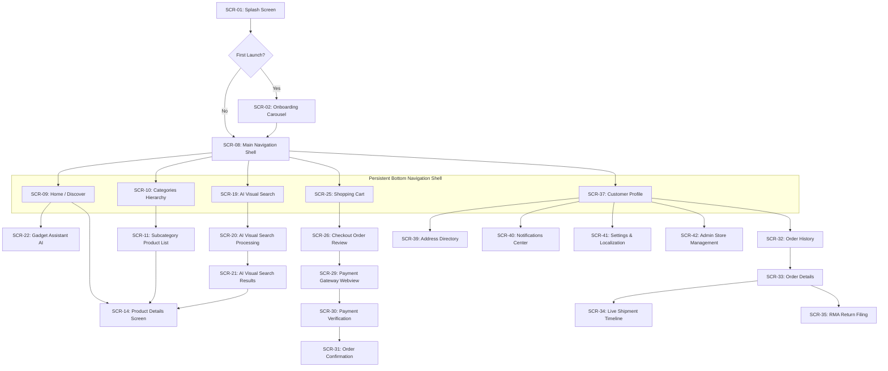

# TechKart Mobile App: UI/UX Screen Architecture & Master Interface Plan

**Document Version:** 1.0.0  
**Target Platform:** Flutter (iOS & Android)  
**Backend Alignment:** Core PHP REST API & MySQL 8.0  
**AI Microservices:** Computer Vision Inference & NLP Language Assistant  
**Design Philosophy:** Modern "Cyber-Luxe" Electronics E-Commerce  
**Document Status:** Architecture Baseline & Living Execution Blueprint  

---

## 1. Executive Summary & Architecture Overview

TechKart is an AI-powered electronic gadgets mobile commerce application engineered specifically for tech enthusiasts and gadget shoppers (earbuds, smartwatches, fast chargers, power banks, audio gear, and computer peripherals).

### 1.1 Source Document Foundation
This screen plan synthesizes and operationalizes the three foundational specifications provided in `docs/`:
1. **Software Requirements Specification (SRS v1.0):** Defines 7 core functional requirement clusters (FR-01 to FR-07) and 6 non-functional benchmarks (NFR-01 to NFR-06), mandating <= 3-second screen loading, <= 2-second p95 API latency, non-AI fallback shopping, and bilingual support (English/Bengali).
2. **Database Design & ERD Specification:** Defines 24 relational tables across 6 architectural modules (User Access, Catalogue & Marketplace, Wishlist/Cart/Orders, Payments & Logistics, AI Engines, and Governance/Disputes) with strict relational constraints, price freeze snapshots, and JSON address captures.
3. **Data Flow Diagram (DFD) & Sequence Models:** Defines Level 0, Level 1 (Processes 1.0 through 9.0), and Level 2 detailed subprocesses alongside 5 sequence diagrams establishing the interaction order between Flutter, Core PHP REST API, external AI vision/language engines, payment gateways, and courier webhooks.

### 1.2 Architectural Principles
* **State Management & Architecture:** Layered feature-first Flutter architecture (Presentation, Domain/State, Data/Repository) powered by BLoC / Riverpod for predictable reactive state management.
* **Separation of Concerns:** Zero business logic in UI widgets. Clear contract boundaries between local cache, network repositories, and UI view-models.
* **Non-AI Resilience:** As mandated by SRS Section 3 (Usability), all core shopping experiences (browse, filter, cart, checkout, payment, tracking) function independently even if external AI vision or NLP microservices experience degraded availability.
* **Resilient Connectivity:** Graceful offline handling, optimistic UI updates where safe, and idempotent transaction guards for checkout and payment operations.

---

## 2. Design System & Mobile UI Specification

The TechKart interface adheres to a custom **"Cyber-Luxe Minimal"** aesthetic tailored for consumer hardware and electronics. The visual hierarchy utilizes deep obsidian dark surfaces paired with luminous electric accents, balanced typography, responsive safe-area constraints, and fluid 60/120fps micro-interactions.

### 2.1 Color Tokens & Palette Architecture

```
+-----------------------------------------------------------------------------------+
| Theme Surface Tokens (Dark Mode Default / Light Mode Alternate)                    |
+----------------------+--------------------+---------------------------------------+
| Token Name           | Hex Value          | Semantic Application                  |
+----------------------+--------------------+---------------------------------------+
| color-surface-base   | #0B0F19 (Dark)     | Scaffold background, root viewport    |
|                      | #F8FAFC (Light)    |                                       |
| color-surface-card   | #111827 (Dark)     | Elevated product cards, modal sheets  |
|                      | #FFFFFF (Light)    |                                       |
| color-surface-float  | #1F293D (Dark)     | Floating action bars, chip backgrounds|
|                      | #F1F5F9 (Light)    |                                       |
| color-border-subtle  | rgba(255,255,255,0.08) (Dark) Card borders, dividers, outlines |
|                      | rgba(15,23,42,0.08)   (Light)                         |
| color-accent-primary | #00E5FF            | Electric Cyan: CTAs, primary buttons  |
| color-accent-indigo  | #6366F1            | AI Vision & Chatbot brand accent      |
| color-accent-violet  | #8B5CF6            | Cyber Violet: Featured deals, badges  |
| color-status-success | #10B981            | In Stock, Paid, Delivered             |
| color-status-warning | #F59E0B            | Low Stock (<5 units), In Transit      |
| color-status-danger  | #EF4444            | Out of Stock, Failed, Cancelled       |
| color-text-primary   | #F9FAFB (Dark)     | Headings, product titles, prices      |
|                      | #0F172A (Light)    |                                       |
| color-text-muted     | #9CA3AF (Dark)     | Subtitles, timestamps, specifications |
|                      | #64748B (Light)    |                                       |
+----------------------+--------------------+---------------------------------------+
```

### 2.2 Typography Scale (Inter & Space Grotesk)
* **Brand / Tech Numbers:** *Space Grotesk* for gadget prices, SKUs, order reference IDs (`TK-202610-8492`), and technical spec numbers.
* **Interface & Editorial:** *Inter* for headings, navigation, descriptions, and user dialogs.
* **Bengali Localization:** *Hind Siliguri* or *Noto Sans Bengali* loaded dynamically for Bengali preferred language (`preferred_language = 'bn'`).

```
Scale Tokens:
- font-display-xl : 32px / Bold (700)      -> Hero banners, promotional headlines
- font-title-lg   : 22px / SemiBold (600)  -> Screen headers, product detail titles
- font-title-md   : 18px / SemiBold (600)  -> Section headers, modal sheet titles
- font-body-lg    : 16px / Regular (400)   -> Product descriptions, chat bubbles
- font-body-md    : 14px / Regular (400)   -> Standard card copy, form inputs
- font-caption    : 12px / Medium (500)    -> Spec pills, badges, carrier milestones
- font-mono-data  : 13px / Medium (500)    -> Tracking IDs, order numbers, hex codes
```

### 2.3 Layout Metrics & Grid Foundation
* **Base Grid Unit:** 8pt incremental spacing system (`4px`, `8px`, `12px`, `16px`, `24px`, `32px`, `48px`).
* **Screen Margin:** 16px horizontal gutter on compact mobile devices; 20px on larger phablets/tablets.
* **Component Corner Radii:**
  * Small (Chips, Spec Pills, Badges): `6px`
  * Medium (Product Cards, Input Fields, Standard Buttons): `12px`
  * Large (Bottom Sheets, Elevated Modals, AI Scanner Viewport): `20px`
  * Full (Round Action Buttons, Avatars, Counter Badges): `999px`
* **Safe Areas & System Bars:** Full edge-to-edge rendering with explicit padding around iOS Dynamic Island / home indicators and Android gesture bars.

### 2.4 Micro-Interactions, Motion & Haptics
* **Standard Page Transitions:** Predictive back gestures with 250ms cubic-bezier curve (`curves.easeInOutCubic`).
* **Shimmer Skeletons:** Animated linear gradient sweeps across placeholder cards during asynchronous data fetching (SRS NFR-01 <= 3s load target).
* **Haptic Feedback:**
  * Light impact on bottom-bar tab selection and wishlist toggle.
  * Medium impact on "Add to Cart" and AI image capture shutter.
  * Success pulse pattern on payment confirmation and RMA submission.
* **AI Visual Search Shimmer:** Glowing scanline translation over the captured camera viewport indicating computer vision inference in progress.

### 2.5 Atomic Reusable Component Library
1. **`GadgetProductCard`:** Displays primary image carousel thumbnail, brand moniker, product headline, live price, original price with discount pill, rating star with count, stock availability badge (`In Stock`, `Only 3 Left`, `Sold Out`), and quick-action wishlist heart button.
2. **`VisualSearchReticle`:** Camera viewfinder HUD with dynamic bounding corner guides, flashlight toggle, gallery picker trigger, and active crop dimension hints.
3. **`AssistantChatBubble`:** Dual-alignment conversational bubble supporting rich markdown formatting, streaming typewriter effect, source citation tags, embedded mini gadget cards with direct "View" and "Add to Cart" triggers, and language indicator.
4. **`LiveShipmentTracker`:** Vertical chronological milestone stepper displaying carrier logo (`DHL Express`, `FedEx`, `Pathao`), waybill barcode preview with copy-to-clipboard, timestamped events, and geolocational checkpoint pills.
5. **`StockStatusBadge`:** Dynamic color-coded pill mapping directly to `inventory.quantity_available`:
   * `> 10 units`: Emerald green "In Stock"
   * `1 - 10 units`: Amber warning "Only [N] Remaining"
   * `<= 0 units`: Red outline "Out of Stock"
6. **`PriceDisplay`:** Dual-currency or localized format displaying sales price prominently with strike-through base price and computed percentage discount.
7. **`EmptyStateCard`:** Unified vector illustration with contextual title, explanatory caption, and primary call-to-action button (e.g., "Empty Cart" -> "Explore Trending Gadgets").
8. **`StateAwareButton`:** Primary button widget handling idle, loading spinner, success checkmark, and disabled validation states automatically.

---

## 3. Information Architecture & Navigation Flow

### 3.1 App Shell & Navigation Structure
The application employs a persistent 5-tab Bottom Navigation Shell for high-frequency customer journeys, coupled with a hierarchical modal/push stack for deep transaction and AI experiences.



### 3.2 Role-Based Access Control (RBAC) Navigation Rules
* **Guest User:** Access to Discover (`/home`), Categories (`/categories`), Search (`/search`), Product Details (`/product/:id`), and AI Visual Search (`/ai/visual-search`). Initiating "Add to Wishlist", "Proceed to Checkout", "Gadget Assistant Chat", or "Profile" prompts an inline auth sheet without losing navigation context.
* **Authenticated Customer (`role = 'customer'`):** Unrestricted access to personalized wishlists, cart persistence, checkout, live order tracking, chat history, address directory, and RMA returns.
* **Administrator / Moderator (`role IN ('admin', 'moderator')`):** Retains standard customer shopping shell plus an unlocked **"Store Admin Hub"** card inside the Profile tab navigating to `/admin/dashboard`, `/admin/products`, `/admin/orders`, `/admin/returns`, and `/admin/audit-logs`.

---

## 4. Comprehensive Screen Inventory (48 Screens)

Each screen specification below includes its unique identifier, route, module, architectural purpose, UI structure, interactions, navigation links, state lifecycle, and data bindings.

---

### Module 0: Authentication, Onboarding & Recovery (SCR-01 to SCR-07)

#### SCR-01: Splash & Initializer Screen
* **Route:** `/splash` | **Module:** Core Auth & Initialization | **Priority:** P0 (Critical MVP)
* **Purpose:** Validates local session token, retrieves device localization (`en` vs `bn`), verifies network connectivity, and routes user to Onboarding, Home Shell, or Login.
* **UI Components:** Animated TechKart glowing brand logo, pulsating cyber-cyan progress bar, dynamic status text, and copyright/version stamp.
* **Interactions:** Automatic progression; retry button appears if critical initial configuration API fails.
* **Navigation:** -> `/onboarding` (first launch), -> `/main` (valid session or guest allowed), -> `/auth/login` (expired token requiring re-auth).
* **States:**
  * *Loading:* Glowing logo pulsing animation.
  * *Error:* "Failed to connect to TechKart servers" dialog with "Retry Connection" button.
  * *Success:* Instant fluid fade transition to destination.
* **Data Binding:** Local secure storage (`auth_token`, `preferred_language`), API `GET /api/v1/config`.

#### SCR-02: Onboarding Carousel Screen
* **Route:** `/onboarding` | **Module:** Core Auth & Onboarding | **Priority:** P1 (Core Experience)
* **Purpose:** Introduces value proposition: Curated Electronics, AI-Driven Visual Discovery, and the Conversational Gadget Assistant.
* **UI Components:** 3-step swipeable carousel slides with vector tech illustrations, page indicator dots, "Skip" text button, and primary "Get Started" button.
* **Interactions:** Horizontal drag gestures, tapping indicator dots, tap "Get Started" to persist first-launch completion flag.
* **Navigation:** -> `/main` (enters as guest), or -> `/auth/login` / `/auth/register`.
* **States:** Purely client-side static presentation; zero network latency.
* **Data Binding:** SharedPreferences key `has_completed_onboarding = true`.

#### SCR-03: Login Screen
* **Route:** `/auth/login` | **Module:** Core Auth | **Priority:** P0 (Critical MVP)
* **Purpose:** Authenticates existing customers and administrative staff via email/phone and salted password hash verification.
* **UI Components:** TechKart icon header, Email/Phone text input with format validation, Obscured Password field with reveal toggle, "Remember Me" checkbox, "Forgot Password?" hyperlink, Primary "Sign In" button, and "Continue as Guest" footer.
* **Interactions:** Input keystrokes, password visibility toggle, submission validation, auto-focus management.
* **Navigation:** -> `/main` (on success), -> `/auth/register`, -> `/auth/forgot-password`.
* **States:**
  * *Loading:* "Sign In" button morphs into circular spinner; fields disabled.
  * *Error:* Inline banner: "Invalid credentials or account suspended (`account_status = suspended`)".
  * *Success:* Haptic feedback; routes to target or previous checkout intent.
* **Data Binding:** `POST /api/v1/auth/login` -> binds to `users` (`email`, `password_hash`, `role`, `account_status`).

#### SCR-04: Registration Screen
* **Route:** `/auth/register` | **Module:** Core Auth | **Priority:** P0 (Critical MVP)
* **Purpose:** Captures new account credentials, legal name, contact information, and initial language preference.
* **UI Components:** Full Name input, Email input, Mobile Telephone input (E.164 international format), Password input with real-time strength meter (length, symbol, digit), Language picker pill (`English` / `বাংলা`), Terms & Privacy consent checkbox, Primary "Create Account" button.
* **Interactions:** Dynamic password strength feedback, inline unique email/phone check debounce, language selection.
* **Navigation:** -> `/main` (on registration success), -> `/auth/login`.
* **States:**
  * *Loading:* Form freeze with central cyber shimmer spinner.
  * *Error:* Field-specific error hints (e.g. "Email already registered", "Invalid phone number format").
  * *Success:* Welcome toast, session token persisted in Keychain/Keystore.
* **Data Binding:** `POST /api/v1/auth/register` -> inserts to `users` (`full_name`, `email`, `phone`, `password_hash`, `preferred_language`).

#### SCR-05: Forgot Password Screen
* **Route:** `/auth/forgot-password` | **Module:** Core Auth | **Priority:** P1 (Core Experience)
* **Purpose:** Initiates password recovery workflow via email or SMS verification code.
* **UI Components:** Descriptive icon, instruction copy ("Enter registered email/phone to receive OTP"), input field, "Send Reset Code" primary button, "Back to Login" text link.
* **Interactions:** Input format validation, tap button to trigger verification dispatch.
* **Navigation:** -> `/auth/verify-reset` (passing destination target), <- `/auth/login`.
* **States:**
  * *Loading:* Button loading spinner.
  * *Error:* "Account with specified email not found".
  * *Success:* Confirmation notice with auto-navigation.
* **Data Binding:** `POST /api/v1/auth/forgot-password`.

#### SCR-06: OTP / Password Reset Verification Screen
* **Route:** `/auth/verify-reset` | **Module:** Core Auth | **Priority:** P1 (Core Experience)
* **Purpose:** Verifies 6-digit one-time password code dispatched to customer's email/phone.
* **UI Components:** 6 individual segmented PIN input boxes with auto-advance, 60-second resend countdown timer, "Resend Code" button, "Verify Code" primary button.
* **Interactions:** Auto-paste from clipboard, keyboard auto-advance, resend trigger after cooldown.
* **Navigation:** -> `/auth/new-password` (on valid verification code), <- `/auth/forgot-password`.
* **States:**
  * *Error:* Red highlight on PIN boxes: "Invalid or expired code. Please try again."
  * *Success:* Green checkmark animation; transitions to new password screen.
* **Data Binding:** `POST /api/v1/auth/verify-otp`.

#### SCR-07: Set New Password Screen
* **Route:** `/auth/new-password` | **Module:** Core Auth | **Priority:** P1 (Core Experience)
* **Purpose:** Allows customer to establish a new secure salted password following verified OTP.
* **UI Components:** New Password input field, Confirm New Password field, Password complexity checklist, "Reset Password" primary button.
* **Interactions:** Dynamic checklist validation (minimum 8 characters, capital letter, special symbol, number), password match verification.
* **Navigation:** -> `/auth/login` with success banner.
* **States:**
  * *Error:* "Passwords do not match" or "Password matches previous hash".
  * *Success:* Dialog "Password successfully updated. Please login."
* **Data Binding:** `POST /api/v1/auth/reset-password` -> updates `users.password_hash`.

---

### Module 1: Navigation Shell & Home Discovery (SCR-08 to SCR-13)

#### SCR-08: Main App Navigation Shell
* **Route:** `/main` | **Module:** Global Navigation | **Priority:** P0 (Critical MVP)
* **Purpose:** Houses persistent BottomNavigationBar, stateful IndexedStack preserving tab scroll state, and global floating action triggers.
* **UI Components:** Bottom navigation bar with 5 destinations (Home, Categories, AI Vision, Cart with badge counter, Profile), floating action blur effect, and top-level network status pill.
* **Interactions:** Tapping tab icons with subtle haptic vibration; double-tapping active tab scrolls to top.
* **Navigation:** Orchestrates tabs 0 to 4; supports deep link routing into nested tabs.
* **States:** Always rendered; manages nested sub-navigators.
* **Data Binding:** Cart item count listener, notification unread count listener.

#### SCR-09: Home / Discover Screen
* **Route:** `/home` (Tab 0) | **Module:** Product Catalogue & Discovery | **Priority:** P0 (Critical MVP)
* **Purpose:** Primary storefront showcasing hero tech promotions, category quick-pills, flash gadget deals, AI assistant quick-card, and trending products.
* **UI Components:**
  * Top App Bar with TechKart logo, Language Switcher toggle (`EN` / `বাং`), Search bar with camera shortcut, and Notification Bell (badge counter).
  * Auto-scrolling Hero Banner Carousel (deals on earbuds, power banks, smartwatches).
  * AI Gadget Assistant floating banner card ("Looking for the best noise-cancelling earbuds under $100? Ask Gadget Assistant").
  * Horizontal Category Bubble Bar (Earbuds, Smartwatches, Fast Chargers, Power Banks, Peripherals).
  * "Hot Gadget Deals" horizontal product strip with live countdown timer.
  * Two-column staggered Grid displaying "Trending & New Arrivals" product cards.
* **Interactions:** Pull-to-refresh, horizontal swipe on carousels, tap banner to open promotion, tap camera icon to launch AI Visual Search, tap heart to toggle wishlist.
* **Navigation:** -> `/search`, -> `/ai/visual-search`, -> `/ai/assistant`, -> `/product/:id`, -> `/notifications`.
* **States:**
  * *Loading:* Shimmer skeletons for hero banner, category pills, and product card grid.
  * *Empty:* (Rare) "No products currently available" with refresh button.
  * *Error:* Full-screen error card: "Unable to load catalogue. Tap to retry."
  * *Success:* Smoothly rendered catalogue with infinite scroll pagination.
* **Data Binding:** `GET /api/v1/home/feed`, `GET /api/v1/categories`, `GET /api/v1/products?featured=true` -> `products`, `categories`, `product_images`, `inventory`.

#### SCR-10: Category Hierarchy & Browse Screen
* **Route:** `/categories` (Tab 1) | **Module:** Product Catalogue & Discovery | **Priority:** P0 (Critical MVP)
* **Purpose:** Browse full recursive tree structure of gadget categories (SRS FR-02, Database `categories.parent_category_id`).
* **UI Components:** Dual-pane split view (Left: vertical rail of primary root categories like Audio, Wearables, Power, Accessories; Right: subcategory cards with icon grids).
* **Interactions:** Tap root category to change active subcategory panel; tap subcategory to navigate to filtered product list.
* **Navigation:** -> `/categories/:id` (Subcategory product list), -> `/search`.
* **States:**
  * *Loading:* Vertical skeleton bars on left; card grid skeleton on right.
  * *Empty:* "No subcategories found for this category".
  * *Error:* Retry view with error message.
  * *Success:* Clean synchronized dual-pane browsing experience.
* **Data Binding:** `GET /api/v1/categories/tree` -> `categories` (`category_id`, `parent_category_id`, `category_name`, `is_active`).

#### SCR-11: Subcategory Product List Screen
* **Route:** `/categories/:id` | **Module:** Product Catalogue & Discovery | **Priority:** P0 (Critical MVP)
* **Purpose:** Displays all products belonging to a selected terminal category with live price, stock status, and sorting.
* **UI Components:** Back button, category title header, active filter/sort chip bar, 2-column product card grid, floating scroll-to-top button.
* **Interactions:** Pull-to-refresh, endless pagination scrolling (SRS NFR-01), tap sort/filter chip to open bottom sheet.
* **Navigation:** -> `/product/:id`, -> `/categories/:id/filter`, <- `/categories`.
* **States:**
  * *Loading:* Initial 6-card shimmer skeleton; subtle footer spinner on pagination load.
  * *Empty:* Illustration "No gadgets found in this category" with "Browse Other Categories" button.
  * *Error:* "Failed to load products" with retry button.
  * *Success:* Grid of live product cards.
* **Data Binding:** `GET /api/v1/categories/:id/products?page=1&limit=20` -> `products`, `inventory`, `product_images`.

#### SCR-12: Search & Filter Overlay Screen
* **Route:** `/search` | **Module:** Product Catalogue & Discovery | **Priority:** P0 (Critical MVP)
* **Purpose:** Fast instantaneous search query input with recent search history tags, trending gadget keywords, and camera visual search trigger.
* **UI Components:** Auto-focused search input box with clear button, camera icon button, "Recent Searches" chip row with "Clear All", "Trending Gadget Queries" list (e.g. "65W GaN Charger", "ANC Earbuds", "Magnetic Power Bank").
* **Interactions:** Keystroke entry, tapping recent query chips, swipe-to-delete individual recent search, tap microphone (if enabled) or camera.
* **Navigation:** -> `/search/results?q=:query`, -> `/ai/visual-search`, <- `/home`.
* **States:**
  * *Empty Recent:* Replaces recent section with "Trending tech searches".
  * *Instant Suggestions:* Live dropdown list matching query prefix.
* **Data Binding:** Local search history cache, `GET /api/v1/search/suggestions?q=...`.

#### SCR-13: Search Results & Filtering Screen
* **Route:** `/search/results` | **Module:** Product Catalogue & Discovery | **Priority:** P0 (Critical MVP)
* **Purpose:** Comprehensive search output with multi-attribute filtering (Brand, Price Slider, In-Stock Only, Warranty, Rating) and sorting.
* **UI Components:** Search query summary bar with result count ("124 gadgets found for 'Earbuds'"), horizontal quick filter pills (e.g., `Brand: Anker`, `Price: Under $50`, `In Stock Only`), Sort By dropdown button (`Price: Low to High`, `Price: High to Low`, `Newest`, `Customer Rating`), 2-column product card grid, and Filter Drawer button.
* **Interactions:** Slide price range slider, toggle multi-select checkboxes for brands, apply filters, pull-to-refresh.
* **Navigation:** -> `/product/:id`, -> `/search` (to edit query).
* **States:**
  * *Loading:* Grid skeleton with shimmer effect.
  * *Empty:* "No gadgets match your search filters" with "Reset Filters" action button.
  * *Error:* Retry banner.
  * *Success:* Filtered product cards with active filter tags.
* **Data Binding:** `GET /api/v1/products/search?q=...&brand=...&min_price=...&max_price=...&in_stock=true&sort=...`.

---

### Module 2: Product Catalogue & Gadget Details (SCR-14 to SCR-18)

#### SCR-14: Product Details Screen
* **Route:** `/product/:id` | **Module:** Catalogue & Marketplace | **Priority:** P0 (Critical MVP)
* **Purpose:** Comprehensive master view of an individual gadget showcasing gallery images, live pricing, stock availability, seller information, dynamic hardware specifications, warranty months, customer reviews, and sticky bottom purchase bar.
* **UI Components:**
  * Transparent floating top bar with Back button, Share button, and Wishlist heart button.
  * Multi-image horizontal gallery carousel with page dot indicators (`product_images`).
  * Commercial Headline gadget name, brand tag, and model number (`brand`, `model_number`).
  * Live Retail Price with base price strike-through and discount percentage pill.
  * Live Stock Status indicator (`inventory.quantity_available`): green "In Stock" or amber "Only X left".
  * Hardware Warranty badge (`warranty_months` months manufacturer warranty).
  * Verified Merchant Info card (`sellers.seller_name`, verification badge, rating).
  * Expandable Specification Preview (`product_specifications` e.g., Battery, Charging Wattage, Bluetooth Version).
  * Customer Reviews summary rating bar (1-5 stars, total reviews count, top 2 review snippets).
  * Related Gadgets horizontal recommendations strip.
  * Sticky Bottom Action Bar with "Chat with Assistant about this gadget" icon button, "Add to Cart" secondary button, and "Buy Now" primary electric-cyan button.
* **Interactions:** Swipe image gallery, tap image to open fullscreen gallery, tap spec sheet to expand, tap "Add to Cart" with quantity stepper sheet, tap "Buy Now" to navigate straight to checkout review.
* **Navigation:** -> `/product/:id/gallery`, -> `/product/:id/specs`, -> `/product/:id/reviews`, -> `/cart`, -> `/checkout`, -> `/ai/assistant?product_id=:id`.
* **States:**
  * *Loading:* Complex screen skeleton shimmer placeholder.
  * *Error:* "Product details could not be retrieved" with retry button.
  * *Success:* High-fidelity interactive hardware product sheet.
* **Data Binding:** `GET /api/v1/products/:id` -> joins `products`, `product_images`, `product_specifications`, `inventory`, `sellers`, `product_reviews`.

#### SCR-15: Product Image Gallery & Fullscreen Zoom Screen
* **Route:** `/product/:id/gallery` | **Module:** Catalogue & Marketplace | **Priority:** P1 (Core Experience)
* **Purpose:** Fullscreen immersive inspection of high-resolution multi-angle gadget gallery photos.
* **UI Components:** Fullscreen dark canvas, pinch-to-zoom interactive viewer, thumbnail horizontal filmstrip at bottom, close "X" button, image counter index ("2 of 6").
* **Interactions:** Double-tap zoom, pinch gesture, swipe left/right to advance photos, tap thumbnail to jump.
* **Navigation:** <- `/product/:id`.
* **States:** Smooth progressive image loading with blurhash placeholder.
* **Data Binding:** `product_images` (`image_url`, `display_order`, `is_primary`).

#### SCR-16: Technical Specifications Sheet / Modal
* **Route:** `/product/:id/specs` | **Module:** Catalogue & Marketplace | **Priority:** P1 (Core Experience)
* **Purpose:** Complete table of dynamic EAV (Entity-Attribute-Value) electronic hardware specifications.
* **UI Components:** Draggable bottom sheet / dedicated screen, categorized spec rows (Connectivity, Battery & Power, Dimensions & Weight, Audio Drivers, Compatibility, Box Contents).
* **Interactions:** Vertical scroll, copy spec value to clipboard on long press.
* **Navigation:** Dismiss sheet back to `/product/:id`.
* **States:** Instant display from cached product payload.
* **Data Binding:** `product_specifications` (`spec_name`, `spec_value`).

#### SCR-17: Customer Reviews & Ratings Screen
* **Route:** `/product/:id/reviews` | **Module:** Engagement & Reviews | **Priority:** P1 (Core Experience)
* **Purpose:** Complete customer rating breakdown (1 to 5 stars), rating distribution histogram, verified purchaser badges, and review cards.
* **UI Components:** Average rating headline (e.g. `4.7 / 5.0`), 5-star histogram progress bars, filter pills (`All`, `5 Stars`, `With Photos`, `Verified Purchases`), review item cards (reviewer name, star rating, verified tag, review date, written feedback), floating "Write a Review" button.
* **Interactions:** Filter reviews by star count, vertical pagination scroll, tap "Write a Review" (auth-guarded).
* **Navigation:** -> `/product/:id/reviews/new`, <- `/product/:id`.
* **States:**
  * *Loading:* Review card skeletons.
  * *Empty:* "No reviews yet for this gadget. Be the first to review!"
  * *Success:* Paginated list of verified buyer reviews.
* **Data Binding:** `GET /api/v1/products/:id/reviews` -> `product_reviews` joins `users`.

#### SCR-18: Write Product Review Screen
* **Route:** `/product/:id/reviews/new` | **Module:** Engagement & Reviews | **Priority:** P2 (Polish & Secondary)
* **Purpose:** Allows customers who purchased the gadget to submit star rating and qualitative feedback.
* **UI Components:** Gadget thumbnail snapshot, interactive 5-star rating selector, text area input for review comments, character counter, guidelines notice, "Submit Review" primary button.
* **Interactions:** Tap stars to assign rating score (1-5), type review text, validate minimum length.
* **Navigation:** <- `/product/:id/reviews` upon success with toast notification.
* **States:**
  * *Loading:* "Submitting review..." overlay.
  * *Error:* "You can only review gadgets you have purchased and received."
  * *Success:* Success dialog: "Thank you! Your review is published."
* **Data Binding:** `POST /api/v1/products/:id/reviews` -> inserts to `product_reviews` (`user_id`, `product_id`, `rating`, `review_text`).

---

### Module 3: AI-Powered Intelligence Engines (SCR-19 to SCR-23)

#### SCR-19: AI Visual Search Camera & Capture Screen
* **Route:** `/ai/visual-search` (Tab 2) | **Module:** AI Vision Engine | **Priority:** P0 (Critical MVP)
* **Purpose:** Allows user to capture a gadget photo using the device camera or select from device gallery for AI-based visual matching (SRS FR-03, DFD 3.2).
* **UI Components:**
  * Real-time camera viewfinder preview.
  * Viewfinder HUD with dynamic bounding corners and guideline reticle.
  * Top bar with flashlight toggle button, instructions banner ("Point camera at any gadget: earbuds, smartwatch, charger..."), and close button.
  * Bottom control bar with Gallery picker icon button, central camera shutter button with animated cyan glowing ring, and camera flip button.
* **Interactions:** Tap shutter to take snapshot, tap gallery icon to open system image picker, pinch to digital zoom.
* **Navigation:** -> `/ai/visual-search/processing` (passing image file), <- previous screen.
* **States:**
  * *Permission Request:* Clean permission sheet if camera access is denied with "Enable Camera in Settings" button.
  * *Validation Error:* Instant toast if selected file is unsupported or exceeds 10MB limit (SRS FR-03, DFD 3.2).
* **Data Binding:** Camera controller plugin, image picker plugin.

#### SCR-20: AI Visual Search Processing / Scanning Screen
* **Route:** `/ai/visual-search/processing` | **Module:** AI Vision Engine | **Priority:** P0 (Critical MVP)
* **Purpose:** Displays visual scanning animation while the image is uploaded to cloud storage, validated, and processed by the computer vision inference pipeline (DFD 3.2, Sequence 4.2).
* **UI Components:**
  * Fullscreen dimmed preview of the captured gadget image.
  * High-tech cyber laser scanline animating vertically across the image.
  * Processing phase stepper with checkmarks:
    1. "Uploading image..."
    2. "Classifying gadget category..."
    3. "Matching catalogue vector similarity..."
  * "Cancel Search" text button.
* **Interactions:** Tap cancel to abort the network request; automatic transition upon server response.
* **Navigation:** -> `/ai/visual-search/results` (on match success or partial matches), -> `/ai/visual-search` (if canceled or error).
* **States:**
  * *Loading:* 3-second animated scanning sequence (SRS NFR-01).
  * *Timeout/Error:* "AI Vision service is temporarily taking longer than expected. Tap to retry or search by text" (SRS NFR-01, NFR-06).
* **Data Binding:** `POST /api/v1/ai/visual-search` (multipart image payload) -> creates `visual_searches` (`image_url`, `detected_category`, `model_version`, `search_status`).

#### SCR-21: AI Visual Search Results & Filter Screen
* **Route:** `/ai/visual-search/results` | **Module:** AI Vision Engine | **Priority:** P0 (Critical MVP)
* **Purpose:** Displays ranked catalogue gadget recommendations sorted by similarity score, with detected category pill and filter options (DFD 3.2 Process 3.7, Sequence 4.2).
* **UI Components:**
  * Captured image thumbnail card showing AI detected category (e.g., `Detected: Wireless Earbuds`, `Confidence: 96%`).
  * "Not what you're looking for? Retake Photo" action chip.
  * Similarity rank badges on product cards (`#1 Match - 98% Match`, `#2 Match - 92% Match`).
  * 2-column grid of matching products with live prices and stock status.
  * Standard filter/sort chip bar.
* **Interactions:** Tap match card to view product details, tap retake to reopen camera, filter by price range.
* **Navigation:** -> `/product/:id`, -> `/ai/visual-search` (to retake), -> `/search` (text fallback).
* **States:**
  * *Matches Found:* High-confidence ranked gadget grid.
  * *No Match / Low Confidence:* "We couldn't find an exact visual match in our catalogue" with "Browse similar gadgets in [Detected Category]" and "Ask Gadget Assistant" buttons.
  * *Error:* "Visual search failed to return results. Please try another angle."
* **Data Binding:** `GET /api/v1/ai/visual-search/:id/results` -> `visual_search_results` (`similarity_score`, `rank_position`, `product_id`).

#### SCR-22: Gadget Assistant Conversational AI Screen
* **Route:** `/ai/assistant` | **Module:** AI Conversational Assistant | **Priority:** P0 (Critical MVP)
* **Purpose:** Intelligent conversational shopping agent providing budget-aware, catalogue-grounded gadget recommendations, verified spec explanations, follow-up answers, and bilingual support (SRS FR-04, DFD 3.3, Sequence 4.3).
* **UI Components:**
  * Top bar with Gadget Assistant avatar, online pulse indicator, Language Switcher button (`English` / `বাংলা` toggle), New Chat button, and Sessions History icon button.
  * Disclaimer caption: "Grounded in verified TechKart catalogue specs. Prices & stock are live."
  * Chat messages list:
    * User bubbles (right-aligned).
    * Assistant bubbles (left-aligned, AI indigo accent) featuring streaming text, structured bullet points, and verified explanation notes.
    * Interactive Embedded Product Cards inside assistant responses (showing gadget photo, name, live price, stock tag, and "Add to Cart" button directly inside chat).
    * Order Status Cards (if customer asks about an order, e.g. "Where is my order TK-202610-8492?").
  * Suggested Prompt Quick-Action Pills above composer (e.g. "Best ANC earbuds under $80?", "Fastest 100W power bank for laptop", "Compare smartwatch battery life").
  * Message composer bar with text input, Bengali phonetic input support, voice dictation shortcut, and send button.
* **Interactions:** Type or tap quick prompt, switch language mid-conversation, tap embedded product card to open details, tap "Add to Cart" directly from chat card, scroll conversation history.
* **Navigation:** -> `/product/:id`, -> `/ai/assistant/sessions`, -> `/orders/:id/track` (from order card), <- previous screen.
* **States:**
  * *Loading / Thinking:* Animated three-dot bouncing shimmer bubble ("Gadget Assistant is analyzing catalogue specs...").
  * *Empty / New Session:* Welcome greeting explaining capabilities in chosen language with 4 starter prompt cards.
  * *Error:* "Assistant is temporarily unavailable. Browse catalogue directly" with retry button (SRS NFR-02 non-AI fallback).
* **Data Binding:** `POST /api/v1/ai/chat/message` (body: `chat_session_id`, `message_text`, `language`) -> reads/writes `chat_sessions`, `chat_messages` (`sender_type`, `message_text`, `product_id`, `order_id`).

#### SCR-23: Gadget Assistant Chat Sessions History Screen
* **Route:** `/ai/assistant/sessions` | **Module:** AI Conversational Assistant | **Priority:** P1 (Core Experience)
* **Purpose:** Lists past conversational threads allowing customers to resume previous gadget advice or research sessions (DB `chat_sessions`).
* **UI Components:** Top header, search bar for past chats, list of past session cards (auto-generated session title, language tag `EN`/`BN`, timestamp, message count, preview snippet), swipe-to-archive/delete action, "Start New Conversation" floating button.
* **Interactions:** Tap session to load dialogue in SCR-22, swipe to delete session, tap start new chat.
* **Navigation:** -> `/ai/assistant?session_id=:id`, <- `/ai/assistant`.
* **States:**
  * *Loading:* Session tile skeletons.
  * *Empty:* "No previous chat sessions. Ask Gadget Assistant for gadget recommendations!"
  * *Success:* Chronological listing of historical chat sessions.
* **Data Binding:** `GET /api/v1/ai/chat/sessions` -> `chat_sessions` (`session_title`, `language`, `session_status`, `created_at`).

---

### Module 4: Wishlist, Cart & Pre-Checkout (SCR-24 to SCR-25)

#### SCR-24: Wishlist Screen
* **Route:** `/wishlist` | **Module:** Wishlist & Cart | **Priority:** P1 (Core Experience)
* **Purpose:** Saved bookmarked gadgets for future consideration with live stock and price drop notifications (SRS FR-02, DB `wishlists`).
* **UI Components:** Top bar with "Wishlist" title and item count, 2-column or list view of saved gadgets, live stock pill, "Move to Cart" button per item, "Add All to Cart" primary action, swipe-to-remove action.
* **Interactions:** Tap "Move to Cart", tap trash to remove from wishlist, tap card to navigate to product details.
* **Navigation:** -> `/product/:id`, -> `/cart`, <- `/home`.
* **States:**
  * *Loading:* Card skeletons.
  * *Empty:* Illustration "Your wishlist is empty. Explore gadgets and tap the heart icon to save items!"
  * *Success:* Clean list of bookmarked gadgets.
* **Data Binding:** `GET /api/v1/wishlist`, `DELETE /api/v1/wishlist/:product_id`, `POST /api/v1/cart/items` -> `wishlists`, `products`, `inventory`.

#### SCR-25: Shopping Cart Screen
* **Route:** `/cart` (Tab 3) | **Module:** Wishlist & Cart | **Priority:** P0 (Critical MVP)
* **Purpose:** Manages active cart items, validates live inventory availability, allows quantity modification, applies promo codes, and calculates subtotal before checkout (SRS FR-05, DFD 3.4 Process 5.1/5.2, DB `carts`, `cart_items`).
* **UI Components:**
  * Header with item count and "Clear Cart" button.
  * Cart Item Tiles: Product thumbnail, name snapshot, selected variant, unit price, quantity increment/decrement steppers (`-`, `qty`, `+`), delete icon button, out-of-stock warning banner if requested quantity exceeds available stock.
  * Free Shipping Progress Bar (e.g., "Add $15 more for Free Express Shipping!").
  * Promo Code / Coupon input field with "Apply" button and discount feedback.
  * Financial Summary Card:
    * Subtotal (`DECIMAL(10,2)`)
    * Estimated Shipping Fee
    * Discount Amount (if coupon applied)
    * Estimated Total
  * Sticky Bottom Action Bar with grand total and primary electric-cyan "Proceed to Checkout" button.
* **Interactions:** Tap `+`/`-` with debounced server sync, swipe to remove item with undo snackbar, apply coupon code, tap "Proceed to Checkout".
* **Navigation:** -> `/checkout` (auth-guarded; prompts login if guest), -> `/product/:id`, -> `/home`.
* **States:**
  * *Loading:* Item row skeletons and summary shimmer.
  * *Stock Warning:* Yellow banner: "Item [X] quantity adjusted due to limited warehouse stock (`inventory.quantity_available`)".
  * *Empty:* Illustration "Your cart is empty" with "Discover Latest Gadgets" button.
  * *Success:* Interactive cart with real-time price calculations.
* **Data Binding:** `GET /api/v1/cart`, `PUT /api/v1/cart/items/:id`, `DELETE /api/v1/cart/items/:id` -> `carts`, `cart_items`, `products`, `inventory`.

---

### Module 5: Checkout & Idempotent Payments (SCR-26 to SCR-31)

#### SCR-26: Checkout Order Review & Summary Screen
* **Route:** `/checkout` | **Module:** Checkout & Payments | **Priority:** P0 (Critical MVP)
* **Purpose:** Multi-step or accordion checkout orchestration: revalidates prices/stock, selects shipping address, selects payment gateway, and initiates order creation (SRS FR-05, DFD 3.4 Process 6.1/6.2/6.3, DB `orders`, `order_items`).
* **UI Components:**
  * Step progress indicator (Address -> Payment -> Review).
  * Shipping Address Card: Displays active default address (recipient name, telephone, full address line, city, state, postal code) with "Change Address" hyperlink button.
  * Order Items Snapshot list: Collapsible accordion showing purchased items, quantities, and locked unit prices.
  * Payment Method Selector Radio Tiles:
    1. Credit / Debit Card (via Stripe / SSLCommerz)
    2. Mobile Financial Services (bKash Wallet)
    3. Cash on Delivery (COD)
  * Server-Side Price Calculation Card:
    * Subtotal
    * Shipping Delivery Fee
    * Applied Discount Amount
    * Net Grand Total (`total_amount`)
  * Security & Return Policy disclaimer ("7-day hassle-free returns & warranty guaranteed").
  * Primary Action Button: "Place Order & Pay $[Total]" with lock icon.
* **Interactions:** Tap "Change Address" to open address picker sheet, select payment radio option, tap "Place Order" to trigger server-side order lock and payment gateway initiation.
* **Navigation:** -> `/checkout/address-select`, -> `/checkout/payment-gateway`, -> `/checkout/verifying`, -> `/checkout/success`, <- `/cart`.
* **States:**
  * *Price/Stock Invalidation Alert:* Modal dialog if item price changed or stock depleted during checkout: "Cart prices have been updated. Please review before proceeding" (DFD 3.4 Process 6.1).
  * *Submitting:* Fullscreen loader with spinner: "Securing inventory and preparing payment gateway...".
  * *Error:* Banner: "Unable to create order. Please try again."
* **Data Binding:** `POST /api/v1/checkout/validate`, `POST /api/v1/orders` -> creates `orders`, `order_items`, `payments`.

#### SCR-27: Delivery Address Selection & Management Modal
* **Route:** `/checkout/address-select` | **Module:** Checkout & Payments | **Priority:** P0 (Critical MVP)
* **Purpose:** Allows customer to choose from existing saved delivery addresses or add a new address during checkout (DB `user_addresses`).
* **UI Components:** Radio list of saved addresses (recipient name, phone, full address, default badge), "+ Add New Address" button, "Deliver to this Address" primary confirmation button.
* **Interactions:** Tap radio button to switch selection, tap edit icon to modify address, tap add new.
* **Navigation:** -> `/profile/addresses/edit` (to add/edit), returns selected `address_id` to `/checkout`.
* **States:**
  * *Empty:* Prompts user directly to fill in address form.
  * *Success:* Clean radio selection list.
* **Data Binding:** `GET /api/v1/user/addresses` -> `user_addresses`.

#### SCR-28: Add / Edit Address Screen
* **Route:** `/profile/addresses/edit` | **Module:** User Profile & Checkout | **Priority:** P0 (Critical MVP)
* **Purpose:** Form to enter recipient name, mobile contact, building/street address, city, state, postal code, and default flag.
* **UI Components:** Recipient Full Name field, Phone number field (with E.164 formatting), Address Line 1 (Street/Building), Address Line 2 (Apartment/Floor - optional), City dropdown/input, State/Division dropdown/input, Postal Code field, "Set as Default Shipping Address" toggle switch, "Save Address" primary button.
* **Interactions:** Form field validation, location autocomplete (if enabled), save address.
* **Navigation:** Returns to calling screen (`/checkout` or `/profile/addresses`).
* **States:**
  * *Loading:* "Saving address...".
  * *Validation Error:* Red inline error hints on empty required fields.
* **Data Binding:** `POST /api/v1/user/addresses` or `PUT /api/v1/user/addresses/:id` -> `user_addresses`.

#### SCR-29: Payment Gateway Webview / SDK Screen
* **Route:** `/checkout/payment-gateway` | **Module:** Checkout & Payments | **Priority:** P0 (Critical MVP)
* **Purpose:** Secure container hosting the payment gateway integration (Stripe Sheet, SSLCommerz webview, or bKash payment portal) with deep link intercept and cancellation detection (SRS FR-05, DFD 3.4, Sequence 4.4).
* **UI Components:** Top secure bar with padlock icon, Gateway provider moniker ("Secured by Stripe / SSLCommerz / bKash"), Cancel / Close button, Embedded secure webview / native SDK view, timeout countdown indicator.
* **Interactions:** Customer inputs card details or bKash PIN, triggers OTP verification; app intercepts redirect callback URLs.
* **Navigation:** -> `/checkout/verifying?order_id=...` (on success or pending callback), -> `/checkout` (on user cancellation with alert).
* **States:**
  * *Loading Webview:* Centered spinner while gateway webview loads.
  * *Cancellation Dialog:* "Are you sure you want to cancel payment? Your order will remain pending."
* **Data Binding:** `payments` (`gateway`, `gateway_order_ref`, `gateway_payment_ref`, `amount`).

#### SCR-30: Payment Processing / Verification Screen
* **Route:** `/checkout/verifying` | **Module:** Checkout & Payments | **Priority:** P0 (Critical MVP)
* **Purpose:** Displays verification animation while the Core PHP backend validates gateway transaction callback idempotently and locks order inventory atomically (DFD 3.4 Process 6.5/6.6, Sequence 4.4).
* **UI Components:** Centered status animation (pulsing shield/lock graphic), descriptive message: "Verifying payment with gateway...", "Please do not close the app or tap back", order number badge (`TK-202610-8492`).
* **Interactions:** Back navigation disabled to prevent duplicate transactions; auto-advances upon verification event.
* **Navigation:** -> `/checkout/success` (on verified payment), -> `/orders/:id` (if payment failed with retry option).
* **States:**
  * *Success:* Instant transition to receipt.
  * *Failure/Pending:* Warning dialog: "Payment failed or timed out. You can retry payment from your orders screen" -> routes to Order Details.
* **Data Binding:** `POST /api/v1/payments/verify` -> updates `payments.payment_status = 'paid'`, `orders.order_status = 'paid'`, marks `carts.status = 'converted'`.

#### SCR-31: Order Confirmation & Receipt Screen
* **Route:** `/checkout/success` | **Module:** Checkout & Payments | **Priority:** P0 (Critical MVP)
* **Purpose:** Celebratory order receipt screen displaying order number, estimated delivery date, summary receipt, and direct link to track shipment.
* **UI Components:**
  * Animated celebration checkmark with subtle green confetti particle burst.
  * Headline: "Order Placed Successfully!"
  * Order Reference Pill: `TK-202610-8492` (with copy-to-clipboard button).
  * Estimated Delivery Date banner (e.g. "Expected Delivery: Oct 18 - Oct 20 via DHL Express").
  * Order Summary card: Recipient delivery address snippet, payment method used, total amount paid.
  * Action Buttons: Primary "Track Order Shipment" button, Secondary "Continue Shopping" button.
* **Interactions:** Tap copy order number, tap track order, tap continue shopping.
* **Navigation:** -> `/orders/:id/track`, -> `/home`.
* **States:** Client-side confirmation presentation; zero delay.
* **Data Binding:** Orders receipt data model (`orders`, `payments`, `shipments`).

---

### Module 6: Order Fulfillment, Tracking & RMA Returns (SCR-32 to SCR-36)

#### SCR-32: Order History Screen
* **Route:** `/orders` | **Module:** Orders & Fulfillment | **Priority:** P0 (Critical MVP)
* **Purpose:** Lists all historical and active purchases placed by the customer with status badges, price snapshots, and quick actions (SRS FR-06, DFD 3.5 Process 7.1, DB `orders`).
* **UI Components:**
  * Filter tab bar: `All`, `Active`, `Completed`, `Cancelled`.
  * Order Card Tiles:
    * Order reference number (`order_number`) and creation timestamp.
    * Status Badge: `Pending` (amber), `Paid` (blue), `Processing` (indigo), `Shipped` (cyan), `Completed` (emerald), `Cancelled` (red).
    * Purchased gadget thumbnails strip with total item count.
    * Net Total Amount (`total_amount`).
    * Contextual action buttons: "Track Shipment", "View Details", "Buy Again".
* **Interactions:** Pull-to-refresh, switch filter tabs, tap card to open details, tap "Track Shipment".
* **Navigation:** -> `/orders/:id`, -> `/orders/:id/track`, <- `/profile`.
* **States:**
  * *Loading:* Order card shimmer placeholders.
  * *Empty:* Illustration "No orders found. Discover high-tech gadgets now!" with "Shop Now" button.
  * *Success:* Clean filterable order list.
* **Data Binding:** `GET /api/v1/orders` -> `orders`, `order_items`, `shipments`.

#### SCR-33: Order Details Screen
* **Route:** `/orders/:id` | **Module:** Orders & Fulfillment | **Priority:** P0 (Critical MVP)
* **Purpose:** Complete master invoice and fulfillment status for a specific sales order, including item price freeze snapshots, shipment waybill link, payment transaction details, invoice PDF download, and return request trigger (DB `orders`, `order_items`, `payments`, `shipments`).
* **UI Components:**
  * Header with order number, order date, and overall order status badge.
  * Shipment Status Preview card with progress bar and "Live Tracking" button.
  * Immutable Shipping Address snapshot card (`shipping_address_snapshot` JSON).
  * Purchased Line Items list: Product thumbnail, name snapshot, quantity, unit price snapshot, line total.
  * Payment Details card: Gateway used, transaction reference ID, verified timestamp, payment status.
  * Financial Breakdown: Subtotal, Shipping Fee, Discount, Grand Total.
  * Action Bar: "Download Invoice PDF", "Ask Assistant About This Order", "Request Return / Replacement" (if eligible within return window).
* **Interactions:** Tap "Live Tracking", tap "Ask Assistant" (pre-populates order context in SCR-22), tap "Request Return".
* **Navigation:** -> `/orders/:id/track`, -> `/orders/:id/return`, -> `/ai/assistant?order_id=:id`, <- `/orders`.
* **States:**
  * *Loading:* Invoice skeleton placeholder.
  * *Error:* "Unable to load order details" with retry.
* **Data Binding:** `GET /api/v1/orders/:id` -> `orders`, `order_items`, `payments`, `shipments`, `returns`.

#### SCR-34: Live Shipment Timeline & Waybill Tracking Screen
* **Route:** `/orders/:id/track` | **Module:** Orders & Fulfillment | **Priority:** P0 (Critical MVP)
* **Purpose:** Real-time multi-carrier shipment progress tracker displaying logistics milestones updated via carrier webhooks (SRS FR-06, DFD 3.5 Process 7.2/7.3, Sequence 4.5, DB `shipments`, `shipment_events`).
* **UI Components:**
  * Top card: Courier partner name (`DHL Express`, `FedEx`, `Pathao`), Tracking Waybill Barcode number with copy icon, Estimated Delivery date counter.
  * Stepper timeline with pulsing cyan node on active milestone:
    1. `Manifest Created` (Warehouse packaged)
    2. `In Transit` (Courier sort facility)
    3. `Out for Delivery` (Local courier courier on route)
    4. `Delivered` (Proof of delivery confirmed)
  * Granular Checkpoint Event History list: Chronological descending feed of timestamps, hub locations, and status narratives (`shipment_events.event_description`, `event_time`, `location`).
  * "Courier Updates Sync Live" indicator with manual refresh button.
* **Interactions:** Tap copy waybill, pull-to-refresh to fetch latest webhook milestones.
* **Navigation:** <- `/orders/:id`.
* **States:**
  * *Loading:* Stepper skeleton animation.
  * *Unassigned:* "Shipment manifest is being created by merchant warehouse."
  * *Delivered:* Celebration delivery badge with proof-of-delivery timestamp.
* **Data Binding:** `GET /api/v1/orders/:id/tracking` -> `shipments`, `shipment_events`.

#### SCR-35: RMA Return Request / Dispute Filing Screen
* **Route:** `/orders/:id/return` | **Module:** Governance & RMA Returns | **Priority:** P1 (Core Experience)
* **Purpose:** Allows customer to initiate Return Merchandise Authorization (RMA) for defective or incorrect gadgets with item selection, reason description, photo evidence upload, and refund calculation (SRS FR-06, DFD 3.5 Process 8.1/8.2, Sequence 4.5, DB `returns`).
* **UI Components:**
  * Target order item selector (checkboxes to choose specific line items being returned).
  * Reason for Return dropdown (e.g. `Defective Hardware / Display Issue`, `Wrong Gadget Model Shipped`, `Missing Accessories`, `Damaged in Transit`).
  * Detailed Narrative text area for defect description.
  * Photo / Video Evidence attachment picker (up to 3 photos of gadget and packaging).
  * Return Method & Refund Estimation card: Calculates refund amount (`refund_amount`), returns policy guidelines, and return shipping instructions.
  * Primary "Submit Return Request" button.
* **Interactions:** Select item, pick reason, attach photos from camera/gallery, submit claim.
* **Navigation:** -> `/returns/:id` (on successful submission), <- `/orders/:id`.
* **States:**
  * *Submitting:* Uploading evidence photos with progress bar.
  * *Validation Error:* "Please select at least one item and provide reason."
  * *Ineligible Alert:* "This order is outside the return window (exceeds return policy period)."
* **Data Binding:** `POST /api/v1/returns` -> inserts to `returns` (`order_id`, `order_item_id`, `user_id`, `reason`, `return_status = 'requested'`, `refund_amount`).

#### SCR-36: RMA Return Status & Refund Tracking Screen
* **Route:** `/returns/:id` | **Module:** Governance & RMA Returns | **Priority:** P1 (Core Experience)
* **Purpose:** Tracks progress of submitted RMA dispute through inspection, merchant approval/rejection, and financial refund settlement (DFD 3.5 Process 8.3, Sequence 4.5).
* **UI Components:**
  * Return Dispute ID banner (e.g., `RMA-202610-0194`).
  * Status Badge: `Requested` (amber), `Inspected` (blue), `Approved` (emerald), `Rejected` (red), `Refunded` (green check).
  * Milestone Stepper:
    1. Claim Filed
    2. Warehouse Inspection
    3. Claim Decision
    4. Refund Credited
  * Refund Summary: Settled refund amount, original payment method credit notice, resolution date timestamp (`resolved_at`).
  * Admin / Merchant Feedback note card (explanation if rejected or approved).
* **Interactions:** Pull-to-refresh to check status updates; tap "Contact Support" if disputed.
* **Navigation:** <- `/orders`.
* **States:** Dynamically reflects database `returns.return_status`.
* **Data Binding:** `GET /api/v1/returns/:id` -> `returns`.

---

### Module 7: Customer Profile, Notifications & Settings (SCR-37 to SCR-41)

#### SCR-37: Customer Profile & Account Hub Screen
* **Route:** `/profile` (Tab 4) | **Module:** User Profile & Governance | **Priority:** P0 (Critical MVP)
* **Purpose:** Central account management hub displaying profile summary, quick-action tiles to orders, wishlist, addresses, settings, language preference, and Store Admin entry (if authorized staff).
* **UI Components:**
  * Profile Header: User avatar, legal name (`full_name`), email (`email`), phone (`phone`), and membership status badge.
  * Quick Metrics Row: Orders count, Wishlist count, Saved Addresses count.
  * **Staff Management Hub Card (Visible only if `role IN ('admin', 'moderator')`):** Distinctive cyber-bordered card titled "TechKart Operations Hub" with direct link to `/admin/dashboard`.
  * Menu List Sections:
    * *My Shopping:* My Orders, My Wishlist, My Reviews.
    * *Account Details:* Personal Information, Saved Delivery Addresses.
    * *Preferences & App:* Language (`English` / `বাংলা`), Notifications, Dark/Light Theme toggle, Security & Passwords.
    * *Support & Legal:* Return Policy, Warranty Information, Privacy Policy, Terms of Service.
    * *Sign Out Button:* Red outline action with confirmation modal.
* **Interactions:** Tap list items to navigate, toggle dark mode switch, tap Sign Out.
* **Navigation:** -> `/profile/edit`, -> `/orders`, -> `/wishlist`, -> `/profile/addresses`, -> `/notifications`, -> `/settings`, -> `/admin/dashboard`.
* **States:**
  * *Guest State:* If not logged in, displays "Sign in to unlock personalized gadget recommendations, wishlists, and order tracking" with primary "Sign In / Register" button.
  * *Authenticated State:* Full profile menu.
* **Data Binding:** `GET /api/v1/user/profile` -> `users`.

#### SCR-38: Edit Profile Screen
* **Route:** `/profile/edit` | **Module:** User Profile | **Priority:** P1 (Core Experience)
* **Purpose:** Modifies account holder full name, contact telephone, and avatar image.
* **UI Components:** Editable avatar with camera upload icon, Full Name field, Phone number field, Email display (read-only with verified badge), "Save Changes" primary button.
* **Interactions:** Select new avatar from gallery, edit text fields, save changes.
* **Navigation:** <- `/profile`.
* **States:**
  * *Loading:* Save indicator.
  * *Success:* Profile updated toast.
* **Data Binding:** `PUT /api/v1/user/profile` -> `users` (`full_name`, `phone`).

#### SCR-39: Saved Addresses Directory Screen
* **Route:** `/profile/addresses` | **Module:** User Profile | **Priority:** P1 (Core Experience)
* **Purpose:** Comprehensive management of customer's multiple geographic delivery destinations (SRS FR-01, DB `user_addresses`).
* **UI Components:** List of address cards (recipient name, phone, address lines, city, state, postal code, default badge), "Set as Default" button, "Edit" button, "Delete" button with confirmation, "+ Add New Address" floating action button.
* **Interactions:** Tap "Set as Default" (updates `is_default = true`), tap edit to open SCR-28, swipe to delete address.
* **Navigation:** -> `/profile/addresses/edit`, <- `/profile`.
* **States:**
  * *Loading:* Address card skeletons.
  * *Empty:* "No saved addresses. Add a delivery destination for faster checkout."
  * *Success:* Multi-address directory.
* **Data Binding:** `GET /api/v1/user/addresses`, `DELETE /api/v1/user/addresses/:id`, `PATCH /api/v1/user/addresses/:id/default`.

#### SCR-40: Notifications Center Screen
* **Route:** `/notifications` | **Module:** Notifications & Alerts | **Priority:** P1 (Core Experience)
* **Purpose:** In-app notification center displaying transactional dispatch alerts, price drop notices on wishlist gadgets, and security warnings (SRS FR-06, DB `notifications`).
* **UI Components:**
  * Top bar with "Notifications" title and "Mark All as Read" button.
  * Notification list cards grouped by `Today`, `This Week`, `Earlier`:
    * Notification type icon (`ORDER_DISPATCHED` -> delivery truck, `PRICE_DROP` -> price tag, `SECURITY_ALERT` -> shield).
    * Title and descriptive message.
    * Timestamp and unread indicator dot (`is_read = false`).
  * Tap card action: Deep links directly into related order (`order_id`) or gadget product page.
* **Interactions:** Tap card to read and navigate, swipe to dismiss notification, tap mark all as read.
* **Navigation:** -> `/orders/:id/track` (if order notification), -> `/product/:id` (if price drop), <- previous screen.
* **States:**
  * *Loading:* Notification skeletons.
  * *Empty:* Illustration "No notifications right now. We'll update you when orders dispatch or prices drop!"
* **Data Binding:** `GET /api/v1/notifications`, `PATCH /api/v1/notifications/:id/read` -> `notifications`.

#### SCR-41: Settings & Preferences Screen
* **Route:** `/settings` | **Module:** User Settings & Localization | **Priority:** P1 (Core Experience)
* **Priority:** P1 (Core Experience)
* **Purpose:** Customizes app behavior: Bilingual localization (`preferred_language`), theme mode, push notification permissions, and biometric security toggle.
* **UI Components:**
  * Language Picker Tile: Radio choices for `English` and `বাংলা (Bengali)` with instant UI locale switch without restart (SRS FR-04, DB `users.preferred_language`).
  * Appearance Tile: Choices for `Dark Mode` (default), `Light Mode`, `System Default`.
  * Push Notification Switches: Order Updates, Price Drop Alerts, Promotional Offers.
  * Biometric Authentication Toggle: Enable FaceID/Fingerprint for quick login and checkout authorization.
  * About TechKart: App version `1.0.0`, Terms of Service, Open Source Licenses.
* **Interactions:** Tapping language selector dynamically updates Flutter locale, toggling theme updates brightness theme data.
* **Navigation:** <- `/profile`.
* **States:** Client-side preference updates synchronized with backend user profile.
* **Data Binding:** `PATCH /api/v1/user/preferences` -> `users.preferred_language`, SharedPreferences.

---

### Module 8: Role-Based Admin & Store Management (SCR-42 to SCR-46)

*Note on Architecture:* As established in the RTM and Ambiguities sections, full-scale catalog authoring and inventory batch uploads are primary web backoffice functions; however, SRS FR-07 and DFD 9.0 mandate administrative role capabilities. Screens SCR-42 through SCR-46 provide a mobile-optimized management suite for warehouse personnel, floor managers, and moderators.

#### SCR-42: Admin Dashboard & Quick Metrics Screen
* **Route:** `/admin/dashboard` | **Module:** Admin Operations | **Priority:** P1 (Core Experience - Staff)
* **Purpose:** High-level operational summary for staff showing pending orders, low stock gadget alerts, unresolved RMA disputes, and quick links.
* **UI Components:**
  * Role Badge (`Administrator` / `Moderator`).
  * 4 KPI Stat Cards: Today's Sales Volume, Pending Orders to Dispatch, Low Stock Products count, Open Return Disputes count.
  * Quick Action Grid: Manage Products, Process Orders, Review Returns, View Audit Logs.
  * "Recent Critical Alerts" list (e.g. "SKU #8492 stock reached 0").
* **Interactions:** Tap KPI cards to filter underlying lists; pull-to-refresh metrics.
* **Navigation:** -> `/admin/products`, -> `/admin/orders`, -> `/admin/returns`, -> `/admin/audit-logs`, <- `/profile`.
* **States:**
  * *Unauthorized:* Redirects non-staff users with "Access Denied: Staff privilege required" error.
  * *Success:* Clean operational dashboard.
* **Data Binding:** `GET /api/v1/admin/dashboard/summary` (guarded by RBAC middleware checking `users.role`).

#### SCR-43: Admin Product & Inventory Management Screen
* **Route:** `/admin/products` | **Module:** Admin Operations | **Priority:** P1 (Core Experience - Staff)
* **Purpose:** Search and quick-adjust gadget inventory quantities, modify retail prices, or toggle active/inactive status (SRS FR-07, DFD 9.0, DB `products`, `inventory`).
* **UI Components:** Search bar by SKU/name, category filter dropdown, product list items showing current price, available stock (`quantity_available`), and status pill (`active`, `draft`, `discontinued`), Quick stock adjustment stepper modal (`+`, `-` units), Price update dialog.
* **Interactions:** Tap stock number to edit, toggle active switch, save stock adjustments.
* **Navigation:** <- `/admin/dashboard`.
* **States:**
  * *Success:* Instant stock adjustment with audit log confirmation.
* **Data Binding:** `GET /api/v1/admin/products`, `PATCH /api/v1/admin/inventory/:product_id` -> updates `inventory`, logs to `audit_logs`.

#### SCR-44: Admin Order Processing Screen
* **Route:** `/admin/orders` | **Module:** Admin Operations | **Priority:** P1 (Core Experience - Staff)
* **Purpose:** Operational fulfillment workflow: review pending paid orders, assign logistics carrier (`DHL Express`, `FedEx`, `Pathao`), enter waybill tracking number, and mark dispatched (SRS FR-07, DFD 9.0, DB `orders`, `shipments`).
* **UI Components:** Order list filterable by `Paid`, `Processing`, `Shipped`, order card displaying order reference, item list, and destination city, Dispatch modal: Carrier dropdown, tracking number text field, "Create Manifest & Mark Shipped" button.
* **Interactions:** Tap order to open dispatch modal, submit tracking information.
* **Navigation:** <- `/admin/dashboard`.
* **States:**
  * *Success:* Updates order status to `shipped` and generates customer notification automatically.
* **Data Binding:** `POST /api/v1/admin/shipments` -> creates `shipments`, updates `orders.order_status = 'shipped'`, inserts `notifications`.

#### SCR-45: Admin RMA Return Dispute Resolution Screen
* **Route:** `/admin/returns` | **Module:** Admin Operations | **Priority:** P1 (Core Experience - Staff)
* **Purpose:** Inspect customer RMA claims, review defect photos, approve replacement or issue financial refund credit (SRS FR-07, DFD 3.5 Process 8.3, DB `returns`).
* **UI Components:**
  * List of pending return claims (`return_status = 'requested'`).
  * Return detail card: Order number, customer name, claimed item, reason, attached defect photos.
  * Resolution Action Sheet:
    * Approve Refund: Enter verified refund amount (`refund_amount`).
    * Reject Claim: Enter mandatory customer explanation narrative.
    * "Finalize Resolution" button.
* **Interactions:** Tap photos to view full size, select resolution, submit decision.
* **Navigation:** <- `/admin/dashboard`.
* **States:**
  * *Success:* Updates `returns.return_status` to `'approved'`, `'rejected'`, or `'refunded'` and logs action to `audit_logs`.
* **Data Binding:** `PATCH /api/v1/admin/returns/:id/resolve` -> `returns`, `audit_logs`, `notifications`.

#### SCR-46: Admin Audit Log Viewer Screen
* **Route:** `/admin/audit-logs` | **Module:** Admin Operations | **Priority:** P2 (Polish & Secondary)
* **Purpose:** Review immutable security audit trail of staff administrative interventions (DB `audit_logs`).
* **UI Components:** Filter by action type (`UPDATE_PRICE`, `OVERRIDE_REFUND`, `DISPATCH_ORDER`), chronological event list displaying timestamp, staff user ID/name, action string, affected entity ID, and client IP address.
* **Interactions:** Infinite scroll pagination, tap log entry to inspect full JSON payload details.
* **Navigation:** <- `/admin/dashboard`.
* **States:** Read-only immutable log stream.
* **Data Binding:** `GET /api/v1/admin/audit-logs` -> `audit_logs`.

---

### Module 9: System, Network & State Fallback Overlays (SCR-47 to SCR-48)

#### SCR-47: Offline & Network Reconnection Overlay
* **Route:** Dynamic Global Dialog / Modal | **Module:** System & Network | **Priority:** P0 (Critical MVP)
* **Purpose:** Graceful handling of network disconnects and offline connectivity states (SRS Section 3 - Compatibility, NFR-05).
* **UI Components:** Non-intrusive floating cyber banner or modal: "No Internet Connection. Reconnecting...", animated offline icon, "Retry Now" button, cached data indicator.
* **Interactions:** Tap "Retry Now" to recheck connectivity; banner automatically dismisses when connection recovers.
* **Navigation:** Overlay remains on top of current screen; does not navigate away.
* **States:** Dynamically triggered via connectivity listener stream.
* **Data Binding:** Flutter `connectivity_plus` plugin.

#### SCR-48: Maintenance & Service Degradation Screen
* **Route:** `/system/maintenance` | **Module:** System & Network | **Priority:** P2 (Polish & Secondary)
* **Purpose:** Informs users if backend REST API is undergoing scheduled database maintenance or version migration.
* **UI Components:** Hardware maintenance illustration, clear explanation notice ("TechKart is currently upgrading systems to serve you better"), estimated completion time, "Check Status" button.
* **Interactions:** Tap "Check Status" to ping health check endpoint.
* **Navigation:** Replaces route if API returns HTTP 503 Maintenance mode.
* **States:** Full viewport block.
* **Data Binding:** API `GET /api/v1/health`.

---

## 5. End-to-End User Journeys

### Journey 1: Customer Onboarding & Language Selection
1. Customer launches TechKart for the first time -> `SCR-01` (Splash) performs environmental verification and detects first launch.
2. System navigates to `SCR-02` (Onboarding Carousel), showcasing AI Visual Search, Curated Gadgets, and Gadget Assistant.
3. Customer taps "Get Started" and is presented with `SCR-04` (Registration).
4. Customer enters full name, email, phone, and sets **Preferred Language to Bengali (`বাং`)**.
5. App registers user, persists auth token, updates Flutter localization to Bengali (`bn`), and opens `SCR-09` (Home Shell) completely localized.

### Journey 2: Standard Gadget Discovery & Live Stock Inspection (Non-AI)
1. Customer browses `SCR-09` (Home) and taps on "Audio & Earbuds" category pill.
2. Navigates to `SCR-11` (Subcategory Product List) showing earbuds sorted by rating.
3. Customer taps filter chip, selects "Brand: Sony" and "Under $100".
4. Taps product card to open `SCR-14` (Product Details).
5. Customer inspects high-res photo gallery (`SCR-15`), views battery and driver specs (`SCR-16`), and checks stock badge ("Only 3 Remaining in Warehouse").
6. Customer taps "Add to Cart" -> bottom sheet confirms item added with cart badge incrementing to `1`.

### Journey 3: AI Visual Gadget Search
1. Customer encounters an unfamiliar pair of wireless earbuds at a friend's desk and opens TechKart.
2. Taps the camera icon in the search bar -> opens `SCR-19` (AI Visual Search Camera).
3. Customer aligns the earbuds inside the cyber reticle and taps the shutter button.
4. Screen transitions to `SCR-20` (AI Processing) showing animated scanlines while image uploads to cloud storage and the AI Vision microservice classifies the gadget and computes vector embeddings.
5. In under 3 seconds, `SCR-21` (Visual Search Results) displays `#1 Match - 98% Match: Soundcore Liberty 4 NC` alongside live pricing and in-stock indicator.
6. Customer taps the match card to navigate to `SCR-14` (Product Details) to purchase.

### Journey 4: Conversational Shopping with Gadget Assistant
1. Customer needs a fast charger for both a laptop and phone and taps "Ask Gadget Assistant" on the Home tab -> opens `SCR-22` (Assistant Chat).
2. Customer types in Bengali: *"আমার ল্যাপটপ এবং ফোনের জন্য ১০০ ওয়াটের একটি ফাস্ট চার্জার লাগবে, বাজেট ৫০০০ টাকার মধ্যে।"* (I need a 100W fast charger for laptop and phone under 5000 BDT).
3. Gadget Assistant analyzes budget constraints, queries catalogue inventory for >=100W GaN chargers, and responds in Bengali with a grounded comparison of the Anker 737 vs Baseus GaN5 Pro.
4. Directly inside the chat stream, the assistant renders two interactive `GadgetProductCard` widgets showing live stock and prices.
5. Customer taps "Add to Cart" directly on the Anker card inside the chat bubble without leaving the conversation.
6. Assistant session is automatically saved to `SCR-23` (Chat Sessions History).

### Journey 5: Pre-Checkout Validation, Address Selection & Multi-Gateway Payment
1. Customer taps the Cart tab -> opens `SCR-25` (Shopping Cart).
2. Cart revalidates stock and prices with the server. Customer taps "Proceed to Checkout".
3. Customer arrives at `SCR-26` (Checkout Order Review) displaying default shipping address.
4. Customer taps "Change Address" -> `SCR-27` allows selection of alternate saved home address.
5. Customer selects "bKash" as payment method and taps "Place Order & Pay".
6. App initializes payment record and opens `SCR-29` (Payment Gateway Webview). Customer enters bKash wallet number and completes OTP/PIN entry.
7. Gateway redirects to callback; app navigates to `SCR-30` (Payment Verification) while Core PHP backend idempotently validates gateway verification and atomically decrements inventory.
8. Customer lands on `SCR-31` (Order Confirmation) displaying order reference `TK-202610-8492` and celebratory animation.

### Journey 6: Post-Purchase Fulfillment, Real-Time Tracking & RMA Dispute
1. Two days later, customer receives an in-app push notification (`SCR-40`): *"Your order TK-202610-8492 has been dispatched via DHL Express!"*
2. Customer taps notification -> opens `SCR-34` (Live Shipment Timeline).
3. Timeline shows live checkpoint milestones received via courier webhooks: `Manifest Created` -> `Sort Facility Arrived` -> `Out for Delivery`.
4. Package is delivered; customer discovers the left earbud has a microphone defect.
5. Customer opens `SCR-33` (Order Details) and taps "Request Return / Replacement".
6. In `SCR-35` (RMA Return Filing), customer selects the earbud line item, selects "Defective Display / Audio", takes two photos of the defect, and submits the RMA claim.
7. Claim transitions to `SCR-36` (RMA Return Status) showing `Status: Requested`.
8. Once warehouse moderator reviews and approves the claim in `SCR-45`, customer receives an approval notification and refund credit confirmation.

---

## 6. Non-Screen System & Background Process Mapping

To guarantee complete traceability with the source documents, the following architectural and database processes identified in `TechKart_Database_Design_Specification.docx` and `TechKart_Data_Flow_Diagram.docx` are explicitly mapped as **requiring no dedicated screen**, operating as automated background services or server-side workflows:

```
+---------------------------------------------------------------------------------------------------------+
| Non-Screen System Process Mapping                                                                       |
+------------------------------------+--------------------------+-----------------------------------------+
| System Process Description         | Source Document Reference| Architectural Implementation Mechanism  |
+------------------------------------+--------------------------+-----------------------------------------+
| Password Hashing & Salt Gen        | DB Spec Table `users`    | Core PHP backend using Argon2id / Bcrypt|
|                                    | SRS FR-01                | during registration/login API calls.    |
+------------------------------------+--------------------------+-----------------------------------------+
| Courier Webhook Ingestion          | DFD 3.5 Process 7.3      | Server-side webhook endpoint receiving  |
|                                    | DB `shipment_events`     | async HTTP POST updates from 3PLs       |
|                                    |                          | (DHL, FedEx, Pathao).                   |
+------------------------------------+--------------------------+-----------------------------------------+
| Atomic Inventory Reservation Hold  | DB Spec Table `inventory`| MySQL row-level lock (`FOR UPDATE`) in  |
|                                    | DFD 3.4 Process 6.6      | PHP transaction during checkout hold.   |
+------------------------------------+--------------------------+-----------------------------------------+
| Idempotent Payment Verification    | DB Spec Table `payments` | Server-to-server gateway callback and   |
|                                    | DFD 3.4 Process 6.5      | unique constraint check on gateway ref. |
+------------------------------------+--------------------------+-----------------------------------------+
| Push Notification Dispatch Service | DB Table `notifications` | FCM (Firebase Cloud Messaging) / APNs   |
|                                    | DFD Level 0 Context      | worker daemon triggering background     |
|                                    |                          | push alerts to customer devices.        |
+------------------------------------+--------------------------+-----------------------------------------+
| Security Audit Log Generation      | DB Table `audit_logs`    | Automated backend repository interceptor|
|                                    | DB Spec Module F         | logging administrative database mutations|
+------------------------------------+--------------------------+-----------------------------------------+
| Address JSON Snapshot Freeze       | DB Table `orders`        | Server-side serialization of address    |
|                                    | `shipping_address_...`   | record into immutable JSON blob on order|
|                                    |                          | placement.                              |
+------------------------------------+--------------------------+-----------------------------------------+
| Historical Cart Conversion Cleanup | DB Table `carts`         | Backend status toggle                   |
|                                    | `status = 'converted'`   | (`carts.status = 'converted'`) executed |
|                                    |                          | upon verified payment callback.         |
+------------------------------------+--------------------------+-----------------------------------------+
```

---

## 7. Requirement Traceability Matrix (RTM)

The matrix below maps every requirement from `SRS_TECHKART.docx`, `TechKart_Database_Design_Specification.docx`, and `TechKart_Data_Flow_Diagram.docx` to its corresponding screen or background system process.

```
+-----------------------------------------------------------------------------------------------------------------------+
| Requirement Traceability Matrix (RTM)                                                                                 |
+--------+---------------------------------------+---------------------+------------+------------------------+----------+
| Req ID | Requirement Narrative / Scope         | Source Reference    | Status     | Mapped Screen(s) / Sys | Priority |
+--------+---------------------------------------+---------------------+------------+------------------------+----------+
| FR-01  | User Registration & Input Validation  | SRS Section 2       | Confirmed  | SCR-04                 | P0       |
|        |                                       | DFD 3.1 / DB: users |            |                        |          |
+--------+---------------------------------------+---------------------+------------+------------------------+----------+
| FR-01b | User Login, Session Security & Roles  | SRS Section 2       | Confirmed  | SCR-01, SCR-03         | P0       |
|        |                                       | DFD 3.1, Seq 4.1    |            |                        |          |
+--------+---------------------------------------+---------------------+------------+------------------------+----------+
| FR-01c | Password Recovery & OTP Verification  | SRS Section 2       | Confirmed  | SCR-05, SCR-06, SCR-07 | P1       |
|        |                                       | DFD 3.1 Process 1.5 |            |                        |          |
+--------+---------------------------------------+---------------------+------------+------------------------+----------+
| FR-01d | Multi-Address Shipping Directory      | SRS Section 2       | Confirmed  | SCR-27, SCR-28, SCR-39 | P0       |
|        |                                       | DB: user_addresses  |            |                        |          |
+--------+---------------------------------------+---------------------+------------+------------------------+----------+
| FR-01e | Profile Details & Language Preference | SRS Section 2       | Confirmed  | SCR-37, SCR-38, SCR-41 | P1       |
|        |                                       | DB: users           |            |                        |          |
+--------+---------------------------------------+---------------------+------------+------------------------+----------+
| FR-02  | Hierarchical Product Categories       | SRS Section 2       | Confirmed  | SCR-09, SCR-10, SCR-11 | P0       |
|        |                                       | DB: categories      |            |                        |          |
+--------+---------------------------------------+---------------------+------------+------------------------+----------+
| FR-02b | Product Search, Multi-Filter & Sort   | SRS Section 2       | Confirmed  | SCR-12, SCR-13         | P0       |
|        |                                       | DFD Level 1 (2.0)   |            |                        |          |
+--------+---------------------------------------+---------------------+------------+------------------------+----------+
| FR-02c | Product Details, Specs, Images & Stock| SRS Section 2       | Confirmed  | SCR-14, SCR-15, SCR-16 | P0       |
|        |                                       | DB: products, specs |            |                        |          |
+--------+---------------------------------------+---------------------+------------+------------------------+----------+
| FR-02d | Customer Wishlist Management          | SRS Section 2       | Confirmed  | SCR-24 (and toggle on  | P1       |
|        |                                       | DB: wishlists       |            | SCR-09, 11, 13, 14)    |          |
+--------+---------------------------------------+---------------------+------------+------------------------+----------+
| FR-02e | Customer Product Ratings & Reviews    | DB: product_reviews | Confirmed  | SCR-17, SCR-18         | P1       |
|        |                                       | DFD Level 1 (8.0)   |            |                        |          |
+--------+---------------------------------------+---------------------+------------+------------------------+----------+
| FR-03  | AI Image Upload & Pre-Validation      | SRS Section 2       | Confirmed  | SCR-19                 | P0       |
|        |                                       | DFD 3.2, Seq 4.2    |            |                        |          |
+--------+---------------------------------------+---------------------+------------+------------------------+----------+
| FR-03b | AI Visual Classification & Similarity | SRS Section 2       | Confirmed  | SCR-20                 | P0       |
|        |                                       | DB: visual_searches |            |                        |          |
+--------+---------------------------------------+---------------------+------------+------------------------+----------+
| FR-03c | Ranked Visual Search Match Display    | SRS Section 2       | Confirmed  | SCR-21                 | P0       |
|        |                                       | DB: visual_search_res|           |                        |          |
+--------+---------------------------------------+---------------------+------------+------------------------+----------+
| FR-04  | Conversational AI Shopping Assistant  | SRS Section 2       | Confirmed  | SCR-22                 | P0       |
|        |                                       | DFD 3.3, Seq 4.3    |            |                        |          |
+--------+---------------------------------------+---------------------+------------+------------------------+----------+
| FR-04b | Budget & Spec Preference Extraction   | SRS Section 2       | Confirmed  | SCR-22                 | P0       |
|        |                                       | DFD 3.3 Process 4.3 |            |                        |          |
+--------+---------------------------------------+---------------------+------------+------------------------+----------+
| FR-04c | Verified Explanations & Citations     | SRS Section 2       | Confirmed  | SCR-22                 | P0       |
|        |                                       | DB: chat_messages   |            |                        |          |
+--------+---------------------------------------+---------------------+------------+------------------------+----------+
| FR-04d | Bilingual Chat (Bengali / English)    | SRS Section 2       | Confirmed  | SCR-22                 | P0       |
|        |                                       | DB: chat_sessions   |            |                        |          |
+--------+---------------------------------------+---------------------+------------+------------------------+----------+
| FR-04e | Chat Session Persistence & History    | DB: chat_sessions   | Confirmed  | SCR-23                 | P1       |
|        |                                       | DB: chat_messages   |            |                        |          |
+--------+---------------------------------------+---------------------+------------+------------------------+----------+
| FR-05  | Persistent Shopping Cart Management   | SRS Section 2       | Confirmed  | SCR-25                 | P0       |
|        |                                       | DB: carts, items    |            |                        |          |
+--------+---------------------------------------+---------------------+------------+------------------------+----------+
| FR-05b | Real-Time Price & Inventory Check     | SRS Section 2       | Confirmed  | SCR-25, SCR-26         | P0       |
|        |                                       | DFD 3.4 Process 6.1 |            |                        |          |
+--------+---------------------------------------+---------------------+------------+------------------------+----------+
| FR-05c | Server-Side Total & Address Selection | SRS Section 2       | Confirmed  | SCR-26, SCR-27         | P0       |
|        |                                       | DFD 3.4 Process 6.2 |            |                        |          |
+--------+---------------------------------------+---------------------+------------+------------------------+----------+
| FR-05d | Multi-Method Payment Gateways         | SRS Section 2       | Confirmed  | SCR-29                 | P0       |
|        | (Stripe, SSLCommerz, bKash, COD)      | DB: payments        |            |                        |          |
+--------+---------------------------------------+---------------------+------------+------------------------+----------+
| FR-05e | Idempotent Verification & Order Lock  | SRS Section 2       | Confirmed  | SCR-30, Non-Screen Sys | P0       |
|        |                                       | DFD 3.4, Seq 4.4    |            |                        |          |
+--------+---------------------------------------+---------------------+------------+------------------------+----------+
| FR-05f | Order Confirmation & Digital Receipt  | SRS Section 2       | Confirmed  | SCR-31                 | P0       |
|        |                                       | DFD 3.4 Process 6.7 |            |                        |          |
+--------+---------------------------------------+---------------------+------------+------------------------+----------+
| FR-06  | Customer Order History & Invoices     | SRS Section 2       | Confirmed  | SCR-32, SCR-33         | P0       |
|        |                                       | DB: orders, items   |            |                        |          |
+--------+---------------------------------------+---------------------+------------+------------------------+----------+
| FR-06b | Real-Time Waybill Tracking & Timeline | SRS Section 2       | Confirmed  | SCR-34                 | P0       |
|        |                                       | DB: shipments       |            |                        |          |
+--------+---------------------------------------+---------------------+------------+------------------------+----------+
| FR-06c | Chatbot Order Status Inquiries        | SRS Section 2       | Confirmed  | SCR-22 (Contextual Card| P1       |
|        |                                       | DB: chat_messages   |            | via chat_messages.order|          |
+--------+---------------------------------------+---------------------+------------+------------------------+----------+
| FR-06d | Push & In-App Status Notifications   | SRS Section 2       | Confirmed  | SCR-40, Non-Screen Sys | P1       |
|        |                                       | DB: notifications   |            |                        |          |
+--------+---------------------------------------+---------------------+------------+------------------------+----------+
| FR-06e | RMA Return Filing & Evidence Upload   | SRS Section 2       | Confirmed  | SCR-35                 | P1       |
|        |                                       | DB: returns, DFD 3.5|            |                        |          |
+--------+---------------------------------------+---------------------+------------+------------------------+----------+
| FR-06f | RMA Resolution & Refund Tracking      | SRS Section 2       | Confirmed  | SCR-36                 | P1       |
|        |                                       | DB: returns         |            |                        |          |
+--------+---------------------------------------+---------------------+------------+------------------------+----------+
| FR-07  | Product, Category & Inventory Admin   | SRS Section 2       | Confirmed  | SCR-42, SCR-43         | P1       |
|        |                                       | DFD Level 1 (9.0)   |            |                        |          |
+--------+---------------------------------------+---------------------+------------+------------------------+----------+
| FR-07b | Order Processing & Waybill Dispatch   | SRS Section 2       | Confirmed  | SCR-44                 | P1       |
|        |                                       | DFD Level 1 (9.0)   |            |                        |          |
+--------+---------------------------------------+---------------------+------------+------------------------+----------+
| FR-07c | Admin RMA Dispute Resolution          | DFD 3.5 Process 8.3 | Confirmed  | SCR-45                 | P1       |
|        |                                       | DB: returns         |            |                        |          |
+--------+---------------------------------------+---------------------+------------+------------------------+----------+
| FR-07d | Immutable Administrative Audit Logs   | DB: audit_logs      | Confirmed  | SCR-46, Non-Screen Sys | P2       |
|        |                                       | DB Spec Module F    |            |                        |          |
+--------+---------------------------------------+---------------------+------------+------------------------+----------+
| NFR-01 | <= 3s Screen Load, <= 2s p95 API      | SRS Section 3       | Confirmed  | All Screens (Shimmers, | P0       |
|        | Pagination & Shimmer Skeletons        | Performance         |            | Pagination)            |          |
+--------+---------------------------------------+---------------------+------------+------------------------+----------+
| NFR-02 | Non-AI Fallback Shopping Experience   | SRS Section 3       | Confirmed  | SCR-09, 10, 11, 14, 25 | P0       |
|        |                                       | Usability           |            | (100% functional solo) |          |
+--------+---------------------------------------+---------------------+------------+------------------------+----------+
| NFR-05 | Network Failure Handling & Retries    | SRS Section 3       | Confirmed  | SCR-47 (Offline Modal),| P0       |
|        |                                       | Compatibility       |            | Idempotent Checkout    |          |
+--------+---------------------------------------+---------------------+------------+------------------------+----------+
```

---

## 8. Document Discrepancies, Ambiguities & Architectural Flags

During our rigorous inspection of `SRS_TECHKART.docx`, `TechKart_Database_Design_Specification.docx`, and `TechKart_Data_Flow_Diagram.docx`, several ambiguities and cross-document inconsistencies were discovered. Rather than making unwarranted assumptions, these are formally cataloged below along with the architecturally recommended resolution:

### Ambiguity 1: Scope of Administrator Functionality (Mobile vs Web Backoffice)
* **Finding:** SRS FR-07 and DFD Process 9.0 define comprehensive administration capabilities: catalogue creation, category trees, bulk inventory adjustments, order dispatching, and audit logs.
* **Tension:** Developing full desktop-grade marketplace administration (e.g. bulk CSV uploads, multi-seller compliance verification) within a mobile Flutter app is typically sub-optimal for operational backoffices.
* **Resolution in Screen Plan:** We established a dedicated mobile **Operations Hub (SCR-42 to SCR-46)** focused strictly on on-the-go warehouse and supervisor tasks: rapid stock quantity tweaks, live order dispatch/manifest creation, RMA inspection approval, and security audit inspection. Complex merchant onboarding (`sellers` verification) is recommended for an administrative web portal.

### Ambiguity 2: Payment Gateway Flow Divergence (Native Sheet vs Redirect Webview)
* **Finding:** The Database Spec defines gateways including `Stripe`, `SSLCommerz`, and `bKash` under `payments.gateway`.
* **Tension:** Stripe supports native in-app bottom sheets (PaymentSheet SDK), whereas regional gateways like SSLCommerz and bKash often operate via hosted checkout URLs requiring in-app webviews with URL-scheme redirect callback intercepts.
* **Resolution in Screen Plan:** `SCR-29` is architected as an adaptive payment container supporting both native mobile payment sheets (Stripe) and hardened in-app WebViews with deep link interception for SSLCommerz and bKash MFS PIN workflows.

### Ambiguity 3: Return Eligibility Window & Policy Enforcement
* **Finding:** The Database Spec includes `warranty_months` in `products` and detailed dispute states in `returns`, but neither the SRS nor the DFD defines the exact return window timeframe (e.g., 7 days, 14 days, or 30 days from delivery).
* **Resolution in Screen Plan:** `SCR-35` implements a configurable return policy window check (defaulting to 7 days from `shipments.delivered_at`). If an order exceeds 7 days post-delivery, the UI dynamically disables the RMA return button and displays manufacturer warranty contact instructions instead.

### Ambiguity 4: Dual-Language Scope (Content vs Interface)
* **Finding:** SRS FR-04 and DB `users.preferred_language` mandate English (`en`) and Bengali (`bn`) support.
* **Tension:** While the UI Chrome (buttons, headers, navigation, chat assistant) is bilingual, gadget titles and hardware specifications from suppliers are typically authored in English.
* **Resolution in Screen Plan:** The Screen Plan implements full dynamic localization for the UI chrome and Gadget Assistant responses, while preserving original English hardware names/model codes in gadget cards to prevent inaccurate transliterations.

---

## 9. Change Management & Living Plan Protocol

This Screen Plan is an evolving architectural blueprint. As user testing, stakeholder reviews, or supplier requirements introduce changes, the following change-management protocol governs modifications.

### 9.1 How to Introduce Newly Discovered Screens
1. **Screen ID Assignment:** Assign the next incremental ID within the appropriate module (e.g., a new seller review screen would become `SCR-49`).
2. **Document Registration:** Update Section 4 of this document with the screen's route, architectural purpose, UI component tree, state lifecycle, and data bindings.
3. **Navigation & Flow Graph Update:** Add the screen node into the Mermaid navigation diagram in Section 3.
4. **RTM Alignment:** Add a corresponding row into the Requirement Traceability Matrix (Section 7).

### 9.2 Upstream Document Synchronization Triggers
Existing foundational documents in `docs/` must be synchronized under the following conditions:
* **SRS Update Required:** Whenever a new screen introduces an entirely new functional capability (e.g., peer-to-peer gadget trade-ins, social sharing feeds, or augmented reality 3D gadget previews).
* **Database Spec Update Required:** Whenever a newly planned screen requires persisting attributes not currently modeled in the 24 tables (e.g., storing delivery GPS coordinates, coupon tables, or seller rating records).
* **DFD Update Required:** Whenever an interaction introduces a new external entity, third-party microservice, or alters the asynchronous sequence of checkout, payment, or order fulfillment.

---

## 10. Implementation Roadmap & Recommended Next Steps

### 10.1 Module Priority Summary

```
+-----------------------------------------------------------------------------------------+
| Module Screen Allocation Summary                                                        |
+---------------------------------------------------------+--------------+----------------+
| Module Domain                                           | Screen Count | Priority Level |
+---------------------------------------------------------+--------------+----------------+
| Module 0: Authentication, Onboarding & Recovery         | 7 Screens    | P0 / P1        |
| Module 1: Navigation Shell & Home Discovery             | 6 Screens    | P0             |
| Module 2: Product Catalogue & Gadget Details            | 5 Screens    | P0 / P1 / P2   |
| Module 3: AI Intelligence (Vision & Gadget Assistant)   | 5 Screens    | P0 / P1        |
| Module 4: Wishlist, Cart & Pre-Checkout                 | 2 Screens    | P0 / P1        |
| Module 5: Checkout & Idempotent Payments                | 6 Screens    | P0             |
| Module 6: Order Fulfillment, Tracking & RMA Returns     | 5 Screens    | P0 / P1        |
| Module 7: Customer Profile, Notifications & Settings    | 5 Screens    | P0 / P1        |
| Module 8: Role-Based Admin Operations                   | 5 Screens    | P1 / P2        |
| Module 9: System & Network Degradation Overlays         | 2 Screens    | P0 / P2        |
+---------------------------------------------------------+--------------+----------------+
| Total Documented Screens                                | 48 Screens   |                |
+---------------------------------------------------------+--------------+----------------+
```

### 10.2 Recommended First Implementation Task
**Task 1: Core Foundation, Theme Architecture & Router Setup**
* Add core dependencies to `pubspec.yaml` (`flutter_bloc` or `riverpod`, `go_router`, `google_fonts`, `dio`, `cached_network_image`).
* Establish the "Cyber-Luxe" design system in `lib/core/theme/` implementing all color, typography, spacing, and component decoration tokens.
* Configure `go_router` in `lib/core/routes/` with the persistent 5-tab Bottom Navigation Shell (`SCR-08`) and route definitions matching this plan.
