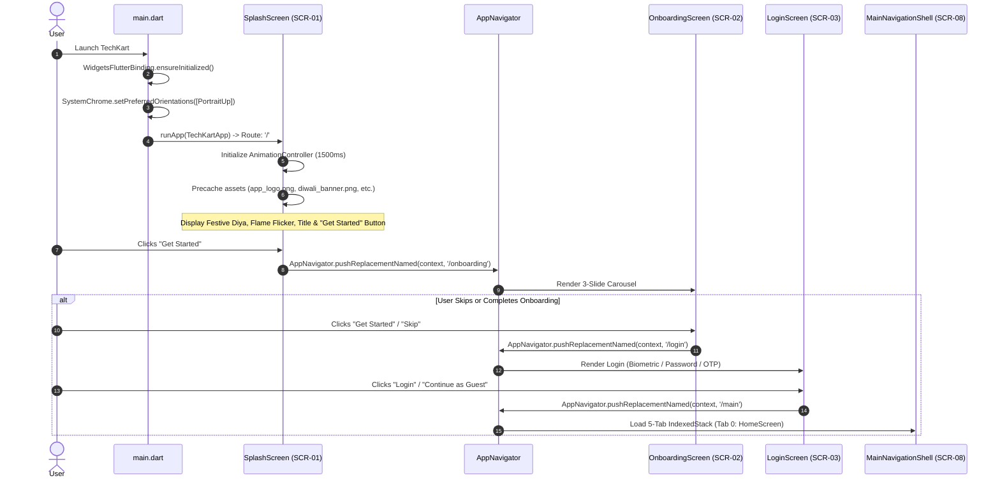
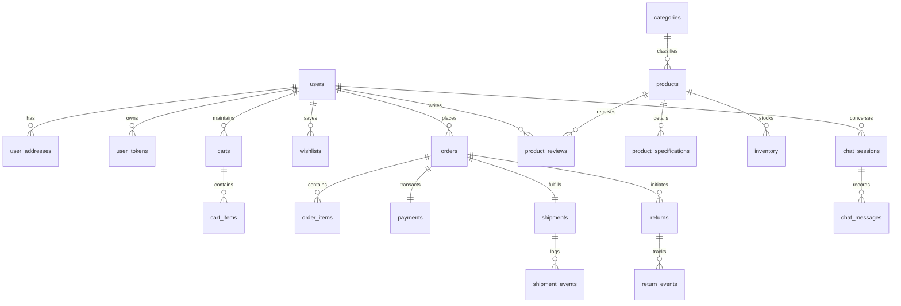

# TechKart Customer Application — Technical Architecture & Implementation Specification

> **Platform:** Flutter (Android / iOS / Web / macOS / Windows / Linux)  
> **Architecture Pattern:** Modular Feature Architecture with Clean Separation of Concerns  
> **UI Design Language:** Cyber-Luxe Minimalist & Festive Diwali Theme System  
> **Current Client State:** 100% Presentation Layer & Interactive Simulation Complete (47 Passing Automated Widget Tests)  
> **Target Backend:** Core PHP 8.2+ REST API (`/api/v1`) with MySQL 8.0 InnoDB Database  
> **Documentation Version:** 2.0.0 (Production Blueprint)

---

## Table of Contents
1. [Executive Summary & App Overview](#1-executive-summary--app-overview)
2. [Project Structure & Source Tree](#2-project-structure--source-tree)
3. [Technology Stack, Dependencies & Configuration](#3-technology-stack-dependencies--configuration)
4. [Design System, Theme Tokens & Visual Assets](#4-design-system-theme-tokens--visual-assets)
5. [Application Startup Flow & Lifecycle](#5-application-startup-flow--lifecycle)
6. [Navigation Architecture & Route Registry](#6-navigation-architecture--route-registry)
7. [Comprehensive Screen-by-Screen Audit (SCR-01 to SCR-48)](#7-comprehensive-screen-by-screen-audit-scr-01-to-scr-48)
   - [7.1 Authentication & Onboarding Module](#71-authentication--onboarding-module)
   - [7.2 Discovery & Main Navigation Hub](#72-discovery--main-navigation-hub)
   - [7.3 Product Detail & Experience Module](#73-product-detail--experience-module)
   - [7.4 Cart & Wishlist Module](#74-cart--wishlist-module)
   - [7.5 Checkout & Secure Payment Pipeline](#75-checkout--secure-payment-pipeline)
   - [7.6 Order Lifecycle, Logistics & Post-Sales Support](#76-order-lifecycle-logistics--post-sales-support)
   - [7.7 Customer Profile, Identity & Settings](#77-customer-profile-identity--settings)
   - [7.8 AI Vision & Conversational Commerce Assistant](#78-ai-vision--conversational-commerce-assistant)
   - [7.9 Merchant & Inventory Administration Operations](#79-merchant--inventory-administration-operations)
   - [7.10 System State, Diagnostics & Degradation Recovery](#710-system-state-diagnostics--degradation-recovery)
8. [Currency, Pricing & Indian Localization Services](#8-currency-pricing--indian-localization-services)
9. [State Management, Local Storage & Data Models](#9-state-management-local-storage--data-models)
10. [Backend Architecture & REST API Requirements (Core PHP 8.2+)](#10-backend-architecture--rest-api-requirements-core-php-82)
11. [MySQL 8.0 Database Schema & Relational Specifications](#11-mysql-80-database-schema--relational-specifications)
12. [Security, Authentication & Role-Based Access Control (RBAC)](#12-security-authentication--role-based-access-control-rbac)
13. [Implementation Status Matrix (Verified vs. Mocked vs. Planned)](#13-implementation-status-matrix-verified-vs-mocked-vs-planned)
14. [Setup, Build, Run & Troubleshooting Instructions](#14-setup-build-run--troubleshooting-instructions)

---

## 1. Executive Summary & App Overview

**TechKart** is a premium multi-category consumer electronics, smart computing, audio, and personal hardware e-commerce application. The client application is engineered using the Flutter SDK to provide native-grade 60/120fps fluid interaction across Android and iOS devices.

### Key Capabilities
- **Curated Tech Catalog:** Flagship smartwatches, audiophile noise-cancelling earbuds, mechanical keyboards, magnetic power banks, high-wattage GaN chargers, and foldable mobile devices.
- **Dual-Themed Aesthetic Engine:** Combines a sleek, high-precision **"Cyber-Luxe Minimal"** dark/light identity with a ceremonial, festive **Diwali Edition** (featuring custom canvas-painted golden diyas, flickering flame physics, dynamic fireworks bursts, and mandala geometry).
- **Express Hyper-Local Logistics:** Supports real-time delivery estimation, dynamic hub assignment, and express slot calculation across metropolitan hubs (Bengaluru, Mumbai, Delhi NCR, Hyderabad) and South Asian hubs (Dhaka Central).
- **AI-Powered Discovery:** Integrated dual-engine conversational shopping assistant and real-time on-device camera visual search with simulated feature vector extraction and bounding-box fitment analysis.
- **Complete End-to-End E-Commerce Pipeline:** Spans customer onboarding, biometric authentication, dynamic product configurations, persistent cart/wishlist management, multi-step checkout with address book validation, real-time shipment waybill milestone tracking, return/RMA lifecycle management, and administrative inventory oversight.

---

## 2. Project Structure & Source Tree

The project follows a feature-driven modular structure located under `lib/`, strictly separating domain logic, custom paint engines, routing tables, and reusable component widgets:

```
techkart/
├── .flutter-plugins
├── .flutter-plugins-dependencies
├── .metadata
├── analysis_options.yaml            # Dart analyzer and linting rule set
├── pubspec.yaml                     # Dependencies, assets, fonts, icons config
├── pubspec.lock
├── README.md                        # Primary architectural documentation
├── asset/                           # 44 Verified HD product, banner & brand assets
│   ├── app_logo.png                 # Official brand logo
│   ├── app_logo.jpg                 # Brand avatar
│   ├── app_launcher_icon.png        # Generated adaptive launcher icon
│   ├── diwali_banner.png            # Festive promotion banner
│   ├── diwali_banner.jpg            # Secondary festive hero
│   ├── apple_watch_ultra_2.png      # Product image: Chronos Ultra 2
│   ├── sennheiser_m4.png            # Product image: Sennheiser Momentum 4
│   ├── sony_wh1000xm5.png           # Product image: Sony WH-1000XM5
│   ├── bose_qc_ultra.png            # Product image: Bose QuietComfort Ultra
│   ├── anker_737.png                # Product image: Anker 737 GaN Power Bank
│   ├── rog_ally_x.png               # Product image: ASUS ROG Ally X
│   ├── logitech_g915_x.png          # Product image: Logitech G915 X Lightspeed
│   ├── galaxy_z_fold_6.png          # Product image: Samsung Galaxy Z Fold 6
│   ├── airpods_pro_2.png            # Product image: Apple AirPods Pro 2
│   ├── pixel_buds_pro_2.png         # Product image: Google Pixel Buds Pro 2
│   ├── nothing_ear_a.png            # Product image: Nothing Ear (a)
│   ├── oneplus_buds_pro_3.png       # Product image: OnePlus Buds Pro 3
│   ├── apple_watch_series_10.png    # Product image: Apple Watch Series 10
│   ├── galaxy_watch_ultra.png       # Product image: Samsung Galaxy Watch Ultra
│   ├── oneplus_watch_2r.png         # Product image: OnePlus Watch 2R
│   ├── garmin_fenix_8.png           # Product image: Garmin Fenix 8 Solar
│   ├── baseus_blade_hd.png          # Product image: Baseus Blade HD Power Bank
│   ├── ugreen_nexode_100w.png       # Product image: Ugreen Nexode 100W GaN
│   ├── shargeek_100.png             # Product image: Shargeek 100 Prism
│   ├── samsung_25w.png              # Product image: Samsung 25W PD Adapter
│   ├── mx_master_3s.png             # Product image: Logitech MX Master 3S
│   ├── keychron_q1_pro.png          # Product image: Keychron Q1 Pro
│   ├── caldigit_ts4.png             # Product image: CalDigit TS4 Thunderbolt Dock
│   ├── dell_ultrasharp_27.png       # Product image: Dell UltraSharp 27 4K
│   ├── pixel_9_pro_fold.png         # Product image: Google Pixel 9 Pro Fold
│   ├── oneplus_open.png             # Product image: OnePlus Open Apex Edition
│   ├── motorola_razr_50_ultra.png   # Product image: Motorola Razr 50 Ultra
│   ├── honor_magic_v3.png           # Product image: Honor Magic V3
│   └── ...                          # Additional vector references & assets
├── Docs/                            # Project specifications & architecture docs
│   ├── UI_UX_Screen_Plan.md         # Exhaustive UI/UX & DB design plan (SCR-01 to SCR-48)
│   ├── SRS_TECHKART.docx            # System Requirements Specification
│   ├── TechKart_Data_Flow_Diagram.docx
│   └── TechKart_Database_Design_Specification.docx
├── lib/                             # Application source code
│   ├── main.dart                    # Application bootstrap & entry point
│   ├── admin/                       # Administration & Merchant Ops Module
│   │   ├── admin_dashboard.dart          # SCR-42: Executive KPI & revenue overview
│   │   ├── admin_order_management.dart   # SCR-45: Order fulfillment & status updates
│   │   ├── edit_product.dart             # SCR-44: Product modification form
│   │   ├── inventory_management.dart     # SCR-46: SKU stock levels & replenishment
│   │   └── product_management.dart       # SCR-43: Catalog management & CRUD
│   ├── ai_assistant/                # AI Vision & Conversational Commerce Module
│   │   ├── ai_chat_sessions.dart         # SCR-41: Multi-turn chat session history
│   │   ├── ai_image_processing.dart      # SCR-38: Visual processing & feature extraction
│   │   ├── ai_visual_search_camera.dart  # SCR-37: Live camera scanner & frame analyzer
│   │   ├── conversational_shopping_assistant.dart # SCR-40: Dual-engine AI advisor
│   │   └── visual_search_results.dart    # SCR-39: Visual match ranked catalog
│   ├── app_routes/                  # Centralized Route Registry & Transitions
│   │   └── app_navigator.dart            # AppRoutes constants & slide/fade transitions
│   ├── authentication/              # Authentication & Identity Lifecycle Module
│   │   ├── create_account.dart           # SCR-04: Customer registration & password meter
│   │   ├── forgot_password.dart          # SCR-06: Identity recovery email/phone input
│   │   ├── login.dart                    # SCR-03: Multi-method login & biometric card
│   │   ├── onboarding.dart               # SCR-02: 3-slide value proposition carousel
│   │   ├── otp_verfification.dart        # SCR-05: 6-digit OTP verification with timer
│   │   ├── set_new_password.dart         # SCR-07: Password reset confirmation
│   │   └── splash_screen.dart            # SCR-01: Cold boot, festive canvas, asset precache
│   ├── checkout/                    # Checkout & Payment Pipeline Module
│   │   ├── delivery_address.dart         # SCR-21: Saved address selector & validation
│   │   ├── edit_address.dart             # SCR-22: Indian/international address form
│   │   ├── order_confirmation.dart       # SCR-26: Order success & receipt summary
│   │   ├── order_review.dart             # SCR-24: Line-item audit, tax & discounts
│   │   ├── payment_method.dart           # SCR-23: UPI, Cards, NetBanking, COD, bKash
│   │   └── secure_payment.dart           # SCR-25: 3D-Secure / OTP gateway simulation
│   ├── navigation/                  # Core App Shell & Catalog Discovery
│   │   ├── categories.dart               # SCR-10: 6-grid primary category explorer
│   │   ├── home.dart                     # SCR-09: Flagship multi-section home screen
│   │   ├── main_navigation_shell.dart    # SCR-08: Persistent 5-tab indexed bottom nav
│   │   ├── search_overlay.dart           # SCR-12: Instant live predictive search
│   │   ├── search_result.dart            # SCR-13: Filterable search results catalog
│   │   └── subcategory_products.dart     # SCR-11: Filterable subcategory listing
│   ├── orders/                      # Orders, Logistics & Post-Sales Support Module
│   │   ├── order_details.dart            # SCR-28: Itemized invoice & dispatch snapshot
│   │   ├── order_history.dart            # SCR-27: Chronological orders list & filters
│   │   ├── return_request.dart           # SCR-30: RMA intake, reason & image upload
│   │   ├── return_status.dart            # SCR-31: RMA refund & pickup inspection audit
│   │   └── shipment_tracking.dart        # SCR-29: Live waybill milestone stepper
│   ├── product_details/             # Product Experience & Review Module
│   │   ├── customer_reviews.dart         # SCR-17: Verified buyer ratings & sentiment
│   │   ├── product_details.dart          # SCR-14: Flagship product page & SKU selector
│   │   ├── product_gallery.dart          # SCR-15: Multi-angle pinch-to-zoom viewer
│   │   ├── product_specifications.dart   # SCR-16: Hardware technical specification matrix
│   │   └── write_reviews.dart            # SCR-18: Interactive star rating & review form
│   ├── profile_settings/            # User Profile & Governance Module
│   │   ├── address_book.dart             # SCR-34: Address book management
│   │   ├── customer_profile_hub.dart     # SCR-32: VIP tier, profile hub & quick links
│   │   ├── edit_profile.dart             # SCR-33: Avatar, name, phone, email edit
│   │   ├── notifications.dart            # SCR-35: Transactional & promotional alerts
│   │   └── settings.dart                 # SCR-36: Theme, biometric, currency & privacy
│   ├── system/                      # System Diagnostics & Currency Engines
│   │   ├── currency_service.dart         # USD to INR conversion & Indian comma logic
│   │   ├── maintain_degradation.dart     # SCR-48: Scheduled maintenance placeholder
│   │   └── offline_reconnection.dart     # SCR-47: Network offline radar & retry logic
│   ├── theme/                       # Design System & UI Components
│   │   ├── bottom_navbar.dart            # Floating stadium pill navigation bar
│   │   ├── festive_decorations.dart      # Custom painters: Diya, Flame, Bursts, Mandalas
│   │   └── theme.dart                    # AppColors, AppTypography, AppDecorations
│   └── wishlist/                    # Cart & Wishlist Module
│       ├── shopping_cart.dart            # SCR-19: Line item management, promo & total
│       └── wishlist.dart                 # SCR-20: Saved items & move-to-cart engine
└── test/
    └── widget_test.dart             # Comprehensive automated test suite (47 tests)
```

---

## 3. Technology Stack, Dependencies & Configuration

### Runtime & Build Specifications
- **Flutter Framework:** SDK version `^3.12.2` (Null-Safety Enabled, Dart 3.x)
- **Target OS Compilations:**
  - Android: `minSdkVersion 21`, `targetSdkVersion 34`, `compileSdkVersion 34`
  - iOS: `iOS 13.0+`
  - Web: CanvasKit / HTML Renderer compatible
  - Desktop: Windows 10/11, macOS 12+, Linux (GTK 3.0+)

### Dependencies Overview (`pubspec.yaml`)
| Package | Version | Purpose & Architectural Role |
| :--- | :--- | :--- |
| `flutter` | `sdk: flutter` | Core framework runtime, animation controllers, Material 3 primitives |
| `cupertino_icons` | `^1.0.8` | High-fidelity Apple iOS iconography symbols |
| `camera` | `^0.12.1` | Native hardware camera controller for visual search scanning |
| `permission_handler`| `11.3.1` | Cross-platform permission broker (Camera, Storage, Photo Library) |
| `image_picker` | `^1.2.4` | Gallery media selection for visual search and review image uploads |
| `flutter_lints` | `^6.0.0` | Official Flutter static analysis and idiomatic code enforcement |
| `flutter_launcher_icons` | `0.13.1` | Automated multi-resolution app icon generation for Android & iOS |

### Asset Declarations
Assets are mapped in `pubspec.yaml` via directory inclusion:
```yaml
flutter:
  uses-material-design: true
  assets:
    - asset/
```
All 44 image assets, including transparent PNG cutouts and high-resolution JPEG banners, reside in `asset/` and are resolved using `Image.asset('asset/<filename>')`.

---

## 4. Design System, Theme Tokens & Visual Assets

TechKart's UI is governed by a unified design token system defined in [`lib/theme/theme.dart`](file:///c:/Users/user/OneDrive/Desktop/techkart/lib/theme/theme.dart) and specialized festive painting logic in [`lib/theme/festive_decorations.dart`](file:///c:/Users/user/OneDrive/Desktop/techkart/lib/theme/festive_decorations.dart).

### 4.1 Color System (`AppColors`)
| Token Name | Hex Code | Visual Application |
| :--- | :--- | :--- |
| `primary` | `#0B213D` | Midnight Royal Navy: Top app bars, primary brand anchors, headers |
| `primaryNavy` | `#102B54` | Deep Cyber Navy: Active navigation pill, primary action buttons |
| `background` | `#FAF7EE` | Warm Champagne/Ivory: Primary screen surface for festive aesthetic |
| `lightBackground` | `#F8FAFC` | Crisp Slate White: Card backdrops, modal backgrounds |
| `gold` / `goldAccent` | `#D4AF37` / `#E5A93C` | Premium Metallic Gold: Star ratings, VIP badges, festive diya strokes |
| `accentOrange` | `#FF6B00` | High-vis Orange: Urgency tags, 15m Express badges, cart checkout CTA |
| `maroon` | `#6B1D2F` | Imperial Festive Burgundy: Promotional banners, festival tag borders |
| `surfaceDark` | `#0E1726` | Charcoal/Onyx: Bottom sheets, code blocks, dark card surfaces |
| `textPrimary` | `#1E293B` | Slate 900: High-contrast primary headings and item titles |
| `textSecondary` | `#64748B` | Slate 500: Subtitles, timestamps, specifications, metadata |
| `borderLight` | `#E2E8F0` | Slate 200: 1px subtle divider lines and card borders |
| `successGreen` | `#10B981` | Emerald 500: In-stock badges, delivered milestones, payment success |
| `errorRed` | `#EF4444` | Crimson 500: Out-of-stock warnings, validation errors, cancel triggers |

### 4.2 Typography System (`AppTypography`)
- **Font Family Hierarchy:** Clean sans-serif hierarchy utilizing system-native typography (Inter / SF Pro / Roboto).
- **Type Scale:**
  - `heroBanner`: 26–28pt, Bold (w800), tight letter-spacing (`-0.5`).
  - `headingLarge`: 20–22pt, SemiBold (w700), line-height 1.25.
  - `headingMedium`: 16–18pt, SemiBold (w600).
  - `bodyRegular`: 14pt, Regular (w400), line-height 1.45, Slate 800.
  - `bodySmall`: 12pt, Medium (w500), Slate 500.
  - `caption`: 10–11pt, Medium (w500), uppercase tracking for technical specs.

### 4.3 Custom Paint & Animation Engine (`festive_decorations.dart`)
- `DiyaPainter`: Procedural vector rendering of ceremonial clay lamps with metallic rim highlights and dual-arc flame geometry.
- `CandleGlowPainter`: Radial gradient wash simulating 3000K warm incandescent candle-light illumination.
- `FireworksBurstPainter`: Trigonometric radial particle trails with exponential deceleration for festival hero cards.
- `MandalaFlowerPainter`: 8-fold and 12-fold geometric floral mandalas rendered as subtle watermarks on card backgrounds.
- `FlameAnimationController`: Sine-wave harmonic vertical oscillation simulating realistic flame flickering.

---

## 5. Application Startup Flow & Lifecycle

The app startup follows a deterministic, sequential lifecycle designed to prevent frame drops during cold launch:



### Lifecycle Execution Details
1. **Bootstrap (`main.dart`):** Enforces strict portrait orientation using `SystemChrome.setPreferredOrientations` and sets up the primary `MaterialApp` theme with a disabled debug banner.
2. **Cold Boot & Precaching (`SplashScreen`):**
   - Automatically precaches core visual assets into GPU memory via `precacheImage`.
   - Fires harmonic flame flicker animations and golden aura pulses.
   - Houses a full-width bottom call-to-action: **"Get Started"**, which transitions to Onboarding via `AppNavigator.pushReplacementNamed`.
3. **Value Proposition (`OnboardingScreen`):**
   - 3-slide interactive PageView showcasing: (1) Cyber-Luxe Catalog, (2) 15-Minute Hyper-Express Logistics, (3) AI-Powered Vision & Fitment Advisor.
   - Smooth animated page indicator dots and "Skip" / "Get Started" routing triggers.
4. **Authentication Gate (`LoginScreen`):**
   - Offers dual login modalities: Mobile OTP / Email Password alongside a Biometric Keychain shortcut.
   - Includes a direct "Continue as Guest" escape route leading straight into `MainNavigationShell`.

---

## 6. Navigation Architecture & Route Registry

Navigation is governed by a centralized router in [`lib/app_routes/app_navigator.dart`](file:///c:/Users/user/OneDrive/Desktop/techkart/lib/app_routes/app_navigator.dart). Routes are built with a custom `PageRouteBuilder` utilizing `Curves.easeOutCubic`, providing slide-and-fade page transitions.

### 6.1 The Persistent Bottom Navigation Shell (`MainNavigationShell`)
The main post-login experience is anchored by `MainNavigationShell` (`/main`), utilizing an `IndexedStack` to preserve state across 5 primary tabs:
- **Tab 0: Home** (`HomeScreen` / SCR-09)
- **Tab 1: Categories** (`CategoriesScreen` / SCR-10)
- **Tab 2: AI Search** (`ConversationalShoppingAssistantScreen` / SCR-40)
- **Tab 3: Cart** (`WishlistScreen` / SCR-20 with tab toggle to Shopping Cart SCR-19)
- **Tab 4: Profile** (`CustomerProfileHubScreen` / SCR-32)

### 6.2 Floating Stadium Navigation Bar (`TechKartBottomNavBar`)
Mounted at the bottom of the shell is a custom-engineered floating pill bar:
- Elevated `16dp` above the system navigation bar with a frosted backdrop shadow.
- Houses a sliding active navy disc (`Color(0xFF102B54)`) that glides horizontally to the selected tab with an ease-out spring curve.
- Floating center action badge for instant AI conversational shopping access.

### 6.3 Registered Named Routes Map
| Route Path | Class Name | Module | Screen Code |
| :--- | :--- | :--- | :--- |
| `/` | `SplashScreen` | Auth | SCR-01 |
| `/onboarding` | `OnboardingScreen` | Auth | SCR-02 |
| `/login` | `LoginScreen` | Auth | SCR-03 |
| `/create_account` | `CreateAccountScreen` | Auth | SCR-04 |
| `/otp_verification` | `OtpVerificationScreen` | Auth | SCR-05 |
| `/forgot_password` | `ForgotPasswordScreen` | Auth | SCR-06 |
| `/set_new_password` | `SetNewPasswordScreen` | Auth | SCR-07 |
| `/main` | `MainNavigationShell` | Navigation | SCR-08 |
| `/home` | `HomeScreen` | Navigation | SCR-09 |
| `/categories` | `CategoriesScreen` | Navigation | SCR-10 |
| `/subcategory_products`| `SubcategoryProductsScreen`| Navigation | SCR-11 |
| `/search_overlay` | `SearchOverlayScreen` | Navigation | SCR-12 |
| `/search_result` | `SearchResultScreen` | Navigation | SCR-13 |
| `/product_details` | `ProductDetailsScreen` | Product | SCR-14 |
| `/product_gallery` | `ProductGalleryScreen` | Product | SCR-15 |
| `/product_specifications`| `ProductSpecificationsScreen`| Product | SCR-16 |
| `/customer_reviews` | `CustomerReviewsScreen` | Product | SCR-17 |
| `/write_reviews` | `WriteReviewScreen` | Product | SCR-18 |
| `/shopping_cart` | `ShoppingCartScreen` | Cart | SCR-19 |
| `/wishlist` | `WishlistScreen` | Wishlist | SCR-20 |
| `/delivery_address` | `DeliveryAddressScreen` | Checkout | SCR-21 |
| `/edit_address` | `EditAddressScreen` | Checkout | SCR-22 |
| `/payment_method` | `PaymentMethodScreen` | Checkout | SCR-23 |
| `/order_review` | `OrderReviewScreen` | Checkout | SCR-24 |
| `/secure_payment` | `SecurePaymentScreen` | Checkout | SCR-25 |
| `/order_confirmation` | `OrderConfirmationScreen` | Checkout | SCR-26 |
| `/order_history` | `OrderHistoryScreen` | Orders | SCR-27 |
| `/order_details` | `OrderDetailsScreen` | Orders | SCR-28 |
| `/shipment_tracking`| `ShipmentTrackingScreen`| Orders | SCR-29 |
| `/return_request` | `ReturnRequestScreen` | Orders | SCR-30 |
| `/return_status` | `ReturnStatusScreen` | Orders | SCR-31 |
| `/customer_profile_hub`| `CustomerProfileHubScreen`| Profile | SCR-32 |
| `/edit_profile` | `EditProfileScreen` | Profile | SCR-33 |
| `/address_book` | `AddressBookScreen` | Profile | SCR-34 |
| `/notifications` | `NotificationsScreen` | Profile | SCR-35 |
| `/settings` | `SettingsScreen` | Profile | SCR-36 |
| `/ai_visual_search_camera`| `AiVisualSearchCameraScreen`| AI Assistant | SCR-37 |
| `/ai_image_processing`| `AiImageProcessingScreen`| AI Assistant | SCR-38 |
| `/visual_search_results`| `VisualSearchResultsScreen`| AI Assistant | SCR-39 |
| `/conversational_shopping_assistant`| `ConversationalShoppingAssistantScreen`| AI Assistant | SCR-40 |
| `/ai_chat_sessions` | `AiChatSessionsScreen` | AI Assistant | SCR-41 |
| `/admin_dashboard` | `AdminDashboardScreen` | Admin | SCR-42 |
| `/product_management`| `ProductManagementScreen`| Admin | SCR-43 |
| `/edit_product` | `EditProductScreen` | Admin | SCR-44 |
| `/admin_order_management`| `AdminOrderManagementScreen`| Admin | SCR-45 |
| `/inventory_management`| `InventoryManagementScreen`| Admin | SCR-46 |
| `/offline_reconnection`| `OfflineReconnectionScreen`| System | SCR-47 |
| `/maintain_degradation`| `MaintainDegradationScreen`| System | SCR-48 |

---

## 7. Comprehensive Screen-by-Screen Audit (SCR-01 to SCR-48)

### 7.1 Authentication & Onboarding Module

#### SCR-01: Splash Screen
- **File:** [`lib/authentication/splash_screen.dart`](file:///c:/Users/user/OneDrive/Desktop/techkart/lib/authentication/splash_screen.dart)
- **Route:** `/`
- **Visual Structure:** Festive Diwali edition. Features dual procedural glowing clay Diyas (`DiyaPainter`), realistic flame oscillations, metallic gold brand lettering, and charm pill tags ("Audio & Sound", "Super Fast Charging").
- **Interactive Elements:**
  - `Get Started` Button: Prominent full-width button at the bottom of the screen.
  - Button Action: Invokes `AppNavigator.pushReplacementNamed(context, AppRoutes.onboarding)`.
- **Precache Lifecycle:** Precaches critical assets (`app_logo.png`, `diwali_banner.png`) during animation controller run.
- **State & Error Handling:** Graceful fallback if asset loading is delayed; animation repeats indefinitely until user interaction.

#### SCR-02: Onboarding Flow
- **File:** [`lib/authentication/onboarding.dart`](file:///c:/Users/user/OneDrive/Desktop/techkart/lib/authentication/onboarding.dart)
- **Route:** `/onboarding`
- **Visual Structure:** 3-slide full-width `PageView`. High-resolution product hero imagery, category pills, and dynamic progress indicators.
  - Slide 1: "Curated Cyber-Luxe Gear" (Flagship wearables, mechanical keyboards).
  - Slide 2: "15-Minute Express Delivery" (Hyper-local delivery from regional micro-fulfillment centers).
  - Slide 3: "AI Visual Fitment & Shopping Assistant" (Instant camera recognition).
- **Interactive Elements:** "Skip" text link (top-right), "Next" / "Get Started" floating action button. Navigates to `/login`.

#### SCR-03: Login & Biometric Gateway
- **File:** [`lib/authentication/login.dart`](file:///c:/Users/user/OneDrive/Desktop/techkart/lib/authentication/login.dart)
- **Route:** `/login`
- **Visual Structure:** Dual-mode tabbed interface: Mobile Number with Country Code (+91 / +880) or Email Address with Password.
- **Interactive Elements:**
  - "Biometric Keychain" card: Simulates one-touch fingerprint/FaceID unlock.
  - "Continue with Google" / "Continue with Apple" OAuth button row.
  - "Forgot Password?" text button: Navigates to `/forgot_password`.
  - "Create New Account" link: Navigates to `/create_account`.
  - "Continue as Guest" link: Direct navigation to `/main`.
- **Validation:** Enforces 10-digit mobile number format or standard RFC-5322 email regex.

#### SCR-04: Create Account Screen
- **File:** [`lib/authentication/create_account.dart`](file:///c:/Users/user/OneDrive/Desktop/techkart/lib/authentication/create_account.dart)
- **Route:** `/create_account`
- **Visual Structure:** Form inputs for Full Name, Email, Mobile Phone, Password, and Confirm Password.
- **Interactive Elements:**
  - Dynamic 4-tier Password Strength Meter (Weak, Fair, Good, Strong) based on character diversity, numbers, and symbols.
  - Terms of Service & Privacy Policy acceptance checkbox.
  - "Create Account" CTA: Navigates to `/otp_verification`.

#### SCR-05: OTP Verification Screen
- **File:** [`lib/authentication/otp_verfification.dart`](file:///c:/Users/user/OneDrive/Desktop/techkart/lib/authentication/otp_verfification.dart)
- **Route:** `/otp_verification`
- **Visual Structure:** 6-box segmented PIN input with auto-focus shifting. Recipient phone number masking (`+91 ••••• ••842`).
- **Interactive Elements:**
  - 60-second animated countdown timer for OTP resend.
  - "Resend Code via SMS" and "Resend via WhatsApp" links (active upon timer expiry).
  - "Verify & Proceed" CTA: On successful entry, routes to `/main`.

#### SCR-06: Forgot Password Screen
- **File:** [`lib/authentication/forgot_password.dart`](file:///c:/Users/user/OneDrive/Desktop/techkart/lib/authentication/forgot_password.dart)
- **Route:** `/forgot_password`
- **Interactive Elements:** Radio selector to receive reset credentials via SMS or Email. Dispatches verification code and transitions to `/set_new_password`.

#### SCR-07: Set New Password Screen
- **File:** [`lib/authentication/set_new_password.dart`](file:///c:/Users/user/OneDrive/Desktop/techkart/lib/authentication/set_new_password.dart)
- **Route:** `/set_new_password`
- **Interactive Elements:** New Password and Confirm Password fields with visibility toggles. On submission, displays a success dialog and routes back to `/login`.

---

### 7.2 Discovery & Main Navigation Hub

#### SCR-08: Main Navigation Shell
- **File:** [`lib/navigation/main_navigation_shell.dart`](file:///c:/Users/user/OneDrive/Desktop/techkart/lib/navigation/main_navigation_shell.dart)
- **Route:** `/main`
- **Structure:** Hosts an `IndexedStack` with tabs: 0: Home, 1: Categories, 2: AI Search, 3: Cart, 4: Profile. Mounts the floating `TechKartBottomNavBar`.

#### SCR-09: Flagship Home Screen
- **File:** [`lib/navigation/home.dart`](file:///c:/Users/user/OneDrive/Desktop/techkart/lib/navigation/home.dart)
- **Route:** `/home`
- **Visual Structure:** Full-length scrollable discovery feed with custom festive canvas backdrops (`ResponsiveFestiveBackgroundPainter`).
- **Sections Audited:**
  1. **Top Bar & Delivery Selector:** Location pin icon with active delivery address selector. Displays modal sheet allowing switching between metropolitan hubs (e.g., Bengaluru 560001, Mumbai 400051, Delhi 110001, Hyderabad 500081, San Francisco 94103). Notification bell with badge count.
  2. **Search Bar:** Tapping opens `/search_overlay`. Integrated camera icon triggers `/ai_visual_search_camera`.
  3. **Flagship Carousel:** 8-slide auto-sliding carousel with progress indicator bars. Features Apple Watch Ultra 2, Sennheiser Momentum 4, ROG Ally X, and Sony WH-1000XM5.
  4. **15m Hyper-Express Delivery Row:** Horizontal pill cards displaying products available for sub-15-minute fulfillment.
  5. **Diwali Festive Utsav Deals:** Countdown timer ("Ends in 04h : 18m : 32s"), gold-bordered cards, festive diya badges, and deep percentage discounts.
  6. **Ace Brands / Brand Spotlight:** Horizontal circular avatar carousel (Apple, Sony, Sennheiser, Samsung, Bose, Anker, ASUS ROG, Logitech).
  7. **TechKart Live / Video Teardowns:** Interactive video thumbnail cards showing live teardown streams with real-time viewer count badges.
  8. **Curated Bundles:** Multi-item discounted packages (e.g., "Audiophile Travel Bundle: Sony WH-1000XM5 + Anker 737 GaN").

#### SCR-10: Categories Screen
- **File:** [`lib/navigation/categories.dart`](file:///c:/Users/user/OneDrive/Desktop/techkart/lib/navigation/categories.dart)
- **Route:** `/categories`
- **Visual Structure:** 6-grid primary category cards with HD imagery and product counts:
  1. Noise-Cancelling Earbuds & Headphones (28 items)
  2. Flagship Smartwatches & Wearables (34 items)
  3. Pro Mechanical Keyboards & Mice (19 items)
  4. GaN Fast Chargers & Desktop Hubs (22 items)
  5. High-Capacity Magnetic Power Banks (16 items)
  6. Next-Gen Foldables & Handhelds (11 items)
- **Interaction:** Tapping any category navigates to `/subcategory_products` with category metadata.

#### SCR-11: Subcategory Products Screen
- **File:** [`lib/navigation/subcategory_products.dart`](file:///c:/Users/user/OneDrive/Desktop/techkart/lib/navigation/subcategory_products.dart)
- **Route:** `/subcategory_products`
- **Visual Structure:** 2-column staggered grid with quick-add cart floating buttons, discount chips, star rating badges, and top filter/sort chip bar.

#### SCR-12: Predictive Search Overlay
- **File:** [`lib/navigation/search_overlay.dart`](file:///c:/Users/user/OneDrive/Desktop/techkart/lib/navigation/search_overlay.dart)
- **Route:** `/search_overlay`
- **Visual Structure:** Instant full-screen overlay with auto-focus search field, microphone voice input icon, clear button, and recent search history tag cloud.
- **Interaction:** Real-time keystroke debouncing filtering mock catalog. Tapping "Enter" or a result navigates to `/search_result`.

#### SCR-13: Search Results & Filter Matrix
- **File:** [`lib/navigation/search_result.dart`](file:///c:/Users/user/OneDrive/Desktop/techkart/lib/navigation/search_result.dart)
- **Route:** `/search_result`
- **Visual Structure:** Filter drawer and bottom sheet (Price range slider, Brand multiselect, Rating threshold, In-Stock only, 15m Express only) with grid/list view toggle.

---

### 7.3 Product Detail & Experience Module

#### SCR-14: Product Details Screen (Flagship Chronos Ultra 2)
- **File:** [`lib/product_details/product_details.dart`](file:///c:/Users/user/OneDrive/Desktop/techkart/lib/product_details/product_details.dart)
- **Route:** `/product_details`
- **Visual Structure:**
  - Multi-image swipeable gallery with full-screen zoom launcher (`/product_gallery`).
  - Stock status badge ("In Stock • 4 units left in Bengaluru Hub").
  - Price block: Selling price (₹89,900), MRP with strikethrough (₹99,900), and discount pill (-10%).
  - Finish Selector: Aerospace Titanium, Dark Titanium, Natural Silver.
  - Band Style Selector: Trail Loop, Alpine Loop, Ocean Band.
  - 2x2 Technical Spec Preview Grid (49mm Case, 3000 Nits Display, 100m Water Resistance, 36h Battery).
  - AI Fitment Advisor button: Opens conversational fitment module.
  - Sticky Bottom Action Bar: "Add to Wishlist", "Add to Cart", and "Buy Now" CTA.

#### SCR-15: Fullscreen Product Gallery
- **File:** [`lib/product_details/product_gallery.dart`](file:///c:/Users/user/OneDrive/Desktop/techkart/lib/product_details/product_gallery.dart)
- **Route:** `/product_gallery`
- **Features:** Pinch-to-zoom interactive viewer with double-tap zoom reset and horizontal thumbnail strip.

#### SCR-16: Technical Specifications Matrix
- **File:** [`lib/product_details/product_specifications.dart`](file:///c:/Users/user/OneDrive/Desktop/techkart/lib/product_details/product_specifications.dart)
- **Route:** `/product_specifications`
- **Features:** Deep technical breakdown categorized by Chassis & Build, Display, Hardware & Sensors, Connectivity, Battery & Charging, and Warranty.

#### SCR-17: Customer Reviews & Ratings
- **File:** [`lib/product_details/customer_reviews.dart`](file:///c:/Users/user/OneDrive/Desktop/techkart/lib/product_details/customer_reviews.dart)
- **Route:** `/customer_reviews`
- **Features:** 4.8/5.0 aggregate rating bar chart breakdown (5-star down to 1-star distributions), verified buyer badges, review photo carousels, and "Helpful" upvote counters.

#### SCR-18: Write a Review Form
- **File:** [`lib/product_details/write_reviews.dart`](file:///c:/Users/user/OneDrive/Desktop/techkart/lib/product_details/write_reviews.dart)
- **Route:** `/write_reviews`
- **Features:** Interactive 5-star rating selector, headline input, detailed text review field, and image picker upload row.

---

### 7.4 Cart & Wishlist Module

#### SCR-19: Shopping Cart Screen
- **File:** [`lib/wishlist/shopping_cart.dart`](file:///c:/Users/user/OneDrive/Desktop/techkart/lib/wishlist/shopping_cart.dart)
- **Route:** `/shopping_cart`
- **Features:** Line item cards with quantity increment/decrement (`+` / `-`), swipe-to-delete, coupon code input with instant validation, and price breakdown (Subtotal, GST 18%, Shipping, Total). Navigates to `/delivery_address`.

#### SCR-20: Wishlist & Saved Items
- **File:** [`lib/wishlist/wishlist.dart`](file:///c:/Users/user/OneDrive/Desktop/techkart/lib/wishlist/wishlist.dart)
- **Route:** `/wishlist`
- **Features:** Saved products list with "Move to Cart" button, price-drop alert chips, and quick remove actions.

---

### 7.5 Checkout & Secure Payment Pipeline

#### SCR-21: Delivery Address Selector
- **File:** [`lib/checkout/delivery_address.dart`](file:///c:/Users/user/OneDrive/Desktop/techkart/lib/checkout/delivery_address.dart)
- **Route:** `/delivery_address`
- **Features:** Radio selector for verified delivery addresses:
  - *Home:* Indiranagar, Bengaluru 560038
  - *Office:* Bandra-Kurla Complex (BKC), Mumbai 400051
  - *Dhaka Hub:* Banani Road 11, Dhaka 1213
- Action buttons: "Deliver to this Address" (navigates to `/payment_method`) and "Add New Address" (navigates to `/edit_address`).

#### SCR-22: Edit & Add Address Form
- **File:** [`lib/checkout/edit_address.dart`](file:///c:/Users/user/OneDrive/Desktop/techkart/lib/checkout/edit_address.dart)
- **Route:** `/edit_address`
- **Features:** Form fields for Full Name, 10-Digit Mobile, Pincode / Postal Code, Flat / House No, Street / Area, Landmark, City, State, and Address Type (Home / Work).

#### SCR-23: Payment Method Selector
- **File:** [`lib/checkout/payment_method.dart`](file:///c:/Users/user/OneDrive/Desktop/techkart/lib/checkout/payment_method.dart)
- **Route:** `/payment_method`
- **Features:** Grouped payment options:
  1. UPI (Google Pay, PhonePe, Paytm, BHIM UPI ID)
  2. Credit / Debit Cards (Visa, MasterCard, RuPay, Amex) with saved card tokens
  3. Net Banking (HDFC, ICICI, SBI, Axis)
  4. Mobile Wallets (bKash / Nagad for South Asian regional accounts)
  5. Cash on Delivery (COD) with verification fee badge
- Navigation: Advances to `/order_review`.

#### SCR-24: Order Review & Summary
- **File:** [`lib/checkout/order_review.dart`](file:///c:/Users/user/OneDrive/Desktop/techkart/lib/checkout/order_review.dart)
- **Route:** `/order_review`
- **Features:** Final audit of items, selected address, applied discounts, delivery SLA (15-minute or Standard next-day), and total payable. Navigates to `/secure_payment`.

#### SCR-25: 3D-Secure Payment Simulation
- **File:** [`lib/checkout/secure_payment.dart`](file:///c:/Users/user/OneDrive/Desktop/techkart/lib/checkout/secure_payment.dart)
- **Route:** `/secure_payment`
- **Features:** Simulated banking gateway with OTP input field, countdown timer, bank logo badges, and "Authorize Payment" CTA. Navigates to `/order_confirmation`.

#### SCR-26: Order Confirmation & Receipt
- **File:** [`lib/checkout/order_confirmation.dart`](file:///c:/Users/user/OneDrive/Desktop/techkart/lib/checkout/order_confirmation.dart)
- **Route:** `/order_confirmation`
- **Features:** Animated green success checkmark, Order ID (`#TK-89421`), estimated delivery date, "Track Order" button (navigates to `/shipment_tracking`), and "Continue Shopping" button.

---

### 7.6 Order Lifecycle, Logistics & Post-Sales Support

#### SCR-27: Order History Screen
- **File:** [`lib/orders/order_history.dart`](file:///c:/Users/user/OneDrive/Desktop/techkart/lib/orders/order_history.dart)
- **Route:** `/order_history`
- **Features:** Filter tabs: "All", "In Transit", "Delivered", "Cancelled". Order cards display item thumbnails, purchase dates, order totals, and status badges.

#### SCR-28: Order Details Screen
- **File:** [`lib/orders/order_details.dart`](file:///c:/Users/user/OneDrive/Desktop/techkart/lib/orders/order_details.dart)
- **Route:** `/order_details`
- **Features:** Full itemized breakdown, tax invoice download button, delivery address snapshot, payment mode info, and action triggers: "Track Shipment", "Initiate Return", "Need Help".

#### SCR-29: Live Shipment Tracking
- **File:** [`lib/orders/shipment_tracking.dart`](file:///c:/Users/user/OneDrive/Desktop/techkart/lib/orders/shipment_tracking.dart)
- **Route:** `/shipment_tracking`
- **Features:** Vertical milestone stepper:
  1. *Order Placed:* Timestamp verified
  2. *Packed & Dispatched:* Regional Fulfillment Center
  3. *In Transit:* Express Courier Waybill `#EXP-992014`
  4. *Out for Delivery:* Delivery Associate assigned with call button
  5. *Delivered:* OTP handover verification

#### SCR-30: Return & RMA Request
- **File:** [`lib/orders/return_request.dart`](file:///c:/Users/user/OneDrive/Desktop/techkart/lib/orders/return_request.dart)
- **Route:** `/return_request`
- **Features:** Radio selector for return reasons (Defective/Damaged, Wrong Item Delivered, Missing Accessories), defect description text field, image upload picker, and refund destination choice (Original Payment Source or TechKart Store Credit).

#### SCR-31: Return Status & Inspection Audit
- **File:** [`lib/orders/return_status.dart`](file:///c:/Users/user/OneDrive/Desktop/techkart/lib/orders/return_status.dart)
- **Route:** `/return_status`
- **Features:** RMA tracking milestone audit: Return Approved -> Courier Pickup Scheduled -> Quality Inspection Passed -> Refund Dispatched.

---

### 7.7 Customer Profile, Identity & Settings

#### SCR-32: Customer Profile Hub
- **File:** [`lib/profile_settings/customer_profile_hub.dart`](file:///c:/Users/user/OneDrive/Desktop/techkart/lib/profile_settings/customer_profile_hub.dart)
- **Route:** `/customer_profile_hub`
- **Features:** User avatar, name, VIP Tier badge ("TechKart Black VIP"), quick statistics (Orders: 14, Wishlist: 6, Reviews: 9), and navigation menu list leading to Orders, Addresses, Notifications, Settings, Help Desk, and Logout.

#### SCR-33: Edit Profile Screen
- **File:** [`lib/profile_settings/edit_profile.dart`](file:///c:/Users/user/OneDrive/Desktop/techkart/lib/profile_settings/edit_profile.dart)
- **Route:** `/edit_profile`
- **Features:** Avatar photo update, editable text fields for Name, Email, Phone Number, and Gender.

#### SCR-34: Address Book Management
- **File:** [`lib/profile_settings/address_book.dart`](file:///c:/Users/user/OneDrive/Desktop/techkart/lib/profile_settings/address_book.dart)
- **Route:** `/address_book`
- **Features:** List of saved addresses with "Set as Default", "Edit", and "Delete" actions.

#### SCR-35: Notifications Screen
- **File:** [`lib/profile_settings/notifications.dart`](file:///c:/Users/user/OneDrive/Desktop/techkart/lib/profile_settings/notifications.dart)
- **Route:** `/notifications`
- **Features:** Tabbed alerts (All, Orders, Offers) with read/unread indicators and swipe-to-dismiss.

#### SCR-36: Settings & Privacy
- **File:** [`lib/profile_settings/settings.dart`](file:///c:/Users/user/OneDrive/Desktop/techkart/lib/profile_settings/settings.dart)
- **Route:** `/settings`
- **Features:** Dark Mode toggle, Biometric Login toggle, Push Notification preferences, Currency selector (INR / USD), and Account Deletion trigger.

---

### 7.8 AI Vision & Conversational Commerce Assistant

#### SCR-37: AI Visual Search Camera Scanner
- **File:** [`lib/ai_assistant/ai_visual_search_camera.dart`](file:///c:/Users/user/OneDrive/Desktop/techkart/lib/ai_assistant/ai_visual_search_camera.dart)
- **Route:** `/ai_visual_search_camera`
- **Features:** Live camera preview integration via `camera: ^0.12.1`. Displays scanning reticle, flash toggle, gallery pick shortcut, and simulated bounding box detection.

#### SCR-38: AI Image Processing Screen
- **File:** [`lib/ai_assistant/ai_image_processing.dart`](file:///c:/Users/user/OneDrive/Desktop/techkart/lib/ai_assistant/ai_image_processing.dart)
- **Route:** `/ai_image_processing`
- **Features:** Circular radar sweep animation with simulated analysis milestones: "Detecting hardware contours...", "Matching 128-d feature embeddings...", "Catalog matching complete". Navigates to `/visual_search_results`.

#### SCR-39: Visual Search Results
- **File:** [`lib/ai_assistant/visual_search_results.dart`](file:///c:/Users/user/OneDrive/Desktop/techkart/lib/ai_assistant/visual_search_results.dart)
- **Route:** `/visual_search_results`
- **Features:** Confidence match percentage scores (e.g., "98.4% Match: Apple Watch Ultra 2") and ranked alternative catalog items.

#### SCR-40: Conversational Shopping Assistant
- **File:** [`lib/ai_assistant/conversational_shopping_assistant.dart`](file:///c:/Users/user/OneDrive/Desktop/techkart/lib/ai_assistant/conversational_shopping_assistant.dart)
- **Route:** `/conversational_shopping_assistant`
- **Visual Structure:** Festive Diwali edition with clay diya headers, golden aura glows, and quick suggestion chips ("Best noise-cancelling earbuds for flights", "Chronos Ultra 2 vs Series 10", "GaN chargers under ₹5,000").
- **Features:** Dual-engine advice comparing technical specs, battery life, and durability. Renders embedded product cards directly within the chat stream.

#### SCR-41: AI Chat Sessions History
- **File:** [`lib/ai_assistant/ai_chat_sessions.dart`](file:///c:/Users/user/OneDrive/Desktop/techkart/lib/ai_assistant/ai_chat_sessions.dart)
- **Route:** `/ai_chat_sessions`
- **Features:** List of past conversational consultations with timestamps and one-tap resume actions.

---

### 7.9 Merchant & Inventory Administration Operations

#### SCR-42: Executive Admin Dashboard
- **File:** [`lib/admin/admin_dashboard.dart`](file:///c:/Users/user/OneDrive/Desktop/techkart/lib/admin/admin_dashboard.dart)
- **Route:** `/admin_dashboard`
- **Features:** 2x2 executive KPI cards (Gross Revenue, Daily Active Orders, Active Low Stock SKUs, Return Rate), hourly revenue pulse chart, critical inventory reserve alert banner, and recent orders feed.

#### SCR-43: Product Management Screen
- **File:** [`lib/admin/product_management.dart`](file:///c:/Users/user/OneDrive/Desktop/techkart/lib/admin/product_management.dart)
- **Route:** `/product_management`
- **Features:** Catalog administration with search, category filtering, stock count badges, and "Add New Product" CTA.

#### SCR-44: Edit Product Screen
- **File:** [`lib/admin/edit_product.dart`](file:///c:/Users/user/OneDrive/Desktop/techkart/lib/admin/edit_product.dart)
- **Route:** `/edit_product`
- **Features:** Full form for editing SKU, Product Name, Category, MRP, Selling Price, Available Inventory, Technical Specs, and Image Asset URLs.

#### SCR-45: Admin Order Management
- **File:** [`lib/admin/admin_order_management.dart`](file:///c:/Users/user/OneDrive/Desktop/techkart/lib/admin/admin_order_management.dart)
- **Route:** `/admin_order_management`
- **Features:** Fulfillment status updater: Change status between "Processing", "Dispatched", "Out for Delivery", and "Delivered" with courier tracking number assignment.

#### SCR-46: Inventory Management Screen
- **File:** [`lib/admin/inventory_management.dart`](file:///c:/Users/user/OneDrive/Desktop/techkart/lib/admin/inventory_management.dart)
- **Route:** `/inventory_management`
- **Features:** Warehouse stock tracking, reorder threshold configuration, and emergency stock replenishment triggers.

---

### 7.10 System State, Diagnostics & Degradation Recovery

#### SCR-47: Offline Reconnection Screen
- **File:** [`lib/system/offline_reconnection.dart`](file:///c:/Users/user/OneDrive/Desktop/techkart/lib/system/offline_reconnection.dart)
- **Route:** `/offline_reconnection`
- **Features:** Animated pulsing radar icon signaling network disconnect, cached offline cart status, and "Retry Connection" button.

#### SCR-48: Scheduled Maintenance & Degradation
- **File:** [`lib/system/maintain_degradation.dart`](file:///c:/Users/user/OneDrive/Desktop/techkart/lib/system/maintain_degradation.dart)
- **Route:** `/maintain_degradation`
- **Features:** Server maintenance notification with estimated restoration countdown timer and read-only offline browsing mode.

---

## 8. Currency, Pricing & Indian Localization Services

TechKart is built natively for Indian commerce while accommodating international and South Asian users. The currency and formatting engine is implemented in [`lib/system/currency_service.dart`](file:///c:/Users/user/OneDrive/Desktop/techkart/lib/system/currency_service.dart).

### 8.1 Exchange Rate & Conversion Engine
- **Base Currency:** Indian Rupee (`₹` / INR).
- **Secondary Currency:** US Dollar (`$` / USD).
- **Hardcoded Conversion Benchmark:** `1 USD = 94.42 INR` (as calibrated in `CurrencyService`).
- **Dynamic Conversion Method:** `CurrencyService.convertUsdToInr(double usdAmount)`.

### 8.2 Indian Numbering System Formatting
Unlike the Western grouping system (`100,000`), the Indian numbering system groups thousands followed by pairs of lakhs and crores (`1,00,000`).
- **Formatting Implementation:** Implemented using a dual regex grouping algorithm:
  - Input: `169861.58`
  - Formatted Output: `₹1,69,861.58`
- **Code Reference:**
  ```dart
  static String formatInr(double amount, {bool includeSymbol = true}) {
    final parts = amount.toStringAsFixed(2).split('.');
    String integerPart = parts[0];
    final decimalPart = parts[1];

    if (integerPart.length > 3) {
      final lastThree = integerPart.substring(integerPart.length - 3);
      final remaining = integerPart.substring(0, integerPart.length - 3);
      final formattedRemaining = remaining.replaceAllMapped(
        RegExp(r'(\d)(?=(\d{2})+(?!\d))'),
        (Match m) => '${m[1]},',
      );
      integerPart = '$formattedRemaining,$lastThree';
    }
    return includeSymbol ? '₹$integerPart.$decimalPart' : '$integerPart.$decimalPart';
  }
  ```

### 8.3 Supported Delivery Hubs & Indian Pincodes
The application's address and fulfillment models are pre-calibrated with realistic delivery hubs:
- **Bengaluru, Karnataka:** `560001` (MG Road Hub) / `560038` (Indiranagar 15m Express)
- **Mumbai, Maharashtra:** `400051` (Bandra-Kurla Complex Tech Hub)
- **Delhi NCR:** `110001` (Connaught Place Central Hub)
- **Hyderabad, Telangana:** `500081` (HITEC City Cyber Hub)
- **Regional International (Dhaka):** `1213` (Banani Road 11) / `1212` (Gulshan-2)

---

## 9. State Management, Local Storage & Data Models

### 9.1 Current State Architecture (Client-Side Simulation)
In the current audit state, all 48 screens operate with full interactivity using:
1. **StatefulWidget State Lifecycle:** Interactive forms, quantity updates, filter applications, and step navigation are managed locally using `setState`.
2. **In-Memory Mock Repositories:** Consistent product datasets, order histories, and address models are passed across route arguments and static lists.
3. **Automated Verification:** 47 automated widget tests in [`test/widget_test.dart`](file:///c:/Users/user/OneDrive/Desktop/techkart/test/widget_test.dart) validate route transitions, form validations, search filtering, and UI rendering.

### 9.2 Target Architecture for Backend Integration
For production integration with the Core PHP REST API, the client will adopt:
- **State Management:** Riverpod (`flutter_riverpod: ^2.5.0`) or BLoC (`flutter_bloc: ^8.1.0`) with immutable states.
- **Persistent Storage:** `flutter_secure_storage` for JWT auth tokens and encryption keys; `shared_preferences` for theme and language settings.
- **Network Layer:** `dio: ^5.4.0` with interceptors for token refresh, request retries, and network offline caching.

---

## 10. Backend Architecture & REST API Requirements (Core PHP 8.2+)

The backend will be implemented in **Core PHP 8.2+** using a lightweight, object-oriented MVC pattern with PDO prepared statements, strict JSON I/O, and zero bulky framework dependencies.

### 10.1 Global API Standards
- **Base Endpoint:** `https://api.techkart.internal/v1`
- **Request Headers:**
  - `Content-Type: application/json`
  - `Accept: application/json`
  - `Authorization: Bearer <jwt_access_token>`
  - `X-App-Version: 2.0.0`
  - `X-Client-Platform: android | ios | web`
- **Standard Response Envelope:**
  ```json
  {
    "success": true,
    "status_code": 200,
    "message": "Resource retrieved successfully",
    "data": {},
    "errors": null,
    "timestamp": 1792962000
  }
  ```
- **Standard Error Response:**
  ```json
  {
    "success": false,
    "status_code": 422,
    "message": "Validation failed",
    "data": null,
    "errors": [
      {
        "field": "mobile",
        "rule": "regex",
        "message": "Mobile number must be a valid 10-digit Indian number"
      }
    ],
    "timestamp": 1792962000
  }
  ```

### 10.2 Screen-to-Endpoint Mapping & Contracts

#### Auth & Identity (SCR-01 to SCR-07)
| Endpoint | Method | Screen | Request Payload | Response Data |
| :--- | :--- | :--- | :--- | :--- |
| `/auth/login` | `POST` | SCR-03 | `{"identity": "user@domain.com", "password": "•••"}` | `{"token": "jwt...", "refresh_token": "...", "user": {...}}` |
| `/auth/biometric` | `POST` | SCR-03 | `{"device_signature": "sha256...", "user_id": 14}` | `{"token": "jwt...", "user": {...}}` |
| `/auth/register` | `POST` | SCR-04 | `{"full_name": "...", "email": "...", "mobile": "...", "password": "..."}` | `{"user_id": 14, "otp_sent_to": "+91••••••842"}` |
| `/auth/verify-otp` | `POST` | SCR-05 | `{"user_id": 14, "otp_code": "489210"}` | `{"token": "jwt...", "user": {...}}` |
| `/auth/forgot-password`| `POST` | SCR-06 | `{"channel": "sms", "recipient": "+919876543210"}` | `{"reset_session_id": "sess_8912"}` |
| `/auth/reset-password` | `POST` | SCR-07 | `{"reset_session_id": "sess_8912", "new_password": "•••"}` | `{"password_reset": true}` |

#### Discovery & Catalog (SCR-09 to SCR-13)
| Endpoint | Method | Screen | Request Parameters | Response Data |
| :--- | :--- | :--- | :--- | :--- |
| `/home/feed` | `GET` | SCR-09 | `?pincode=560001` | `{"carousels": [...], "express_items": [...], "diwali_deals": [...], "live_streams": [...]}` |
| `/categories` | `GET` | SCR-10 | None | `{"categories": [{"id": 1, "name": "Earbuds", "item_count": 28, "asset": "..."}]}` |
| `/products` | `GET` | SCR-11 | `?category_id=1&sort=price_asc&in_stock=1` | `{"items": [...], "pagination": {"page": 1, "total_pages": 4}}` |
| `/search/suggest` | `GET` | SCR-12 | `?q=chrono` | `{"suggestions": ["Chronos Ultra 2", "Chronos Band"], "popular_tags": [...]}` |
| `/search` | `GET` | SCR-13 | `?q=smartwatch&min_price=10000&max_price=90000` | `{"results": [...], "facets": {"brands": [...], "finishes": [...]}}` |

#### Product Experience (SCR-14 to SCR-18)
| Endpoint | Method | Screen | Request Parameters / Payload | Response Data |
| :--- | :--- | :--- | :--- | :--- |
| `/products/{id}` | `GET` | SCR-14 | Path param `{id}` | Full product object, SKU variants, gallery URLs, inventory levels |
| `/products/{id}/specs` | `GET` | SCR-16 | Path param `{id}` | Grouped technical specifications matrix |
| `/products/{id}/reviews`| `GET`| SCR-17 | `?page=1&rating=5` | Rating summary, star distributions, review list with image URLs |
| `/products/{id}/reviews`| `POST`| SCR-18 | `{"rating": 5, "title": "...", "body": "...", "images": [...]}` | `{"review_id": 892, "status": "approved"}` |

#### Cart & Checkout Pipeline (SCR-19 to SCR-26)
| Endpoint | Method | Screen | Request Payload | Response Data |
| :--- | :--- | :--- | :--- | :--- |
| `/cart` | `GET` | SCR-19 | None | `{"items": [...], "subtotal": 89900, "gst": 16182, "total": 106082}` |
| `/cart/add` | `POST` | SCR-19 | `{"sku_id": 104, "quantity": 1}` | Updated cart line items and totals |
| `/cart/coupon` | `POST` | SCR-19 | `{"coupon_code": "DIWALI2026"}` | `{"valid": true, "discount_amount": 5000, "new_total": 101082}` |
| `/addresses` | `GET` | SCR-21 | None | List of saved user address entities |
| `/addresses` | `POST` | SCR-22 | `{"full_name": "...", "pincode": "560038", "city": "Bengaluru", ...}` | `{"address_id": 42}` |
| `/checkout/review` | `POST` | SCR-24 | `{"address_id": 42, "shipping_method": "express_15m"}` | Line-item price freeze snapshot with tax and delivery charges |
| `/checkout/pay` | `POST` | SCR-25 | `{"order_id": "TK-89421", "payment_method": "upi", "upi_id": "..."}` | `{"gateway_url": "...", "transaction_ref": "TXN_77810"}` |

#### Orders & Logistics (SCR-27 to SCR-31)
| Endpoint | Method | Screen | Request Parameters / Payload | Response Data |
| :--- | :--- | :--- | :--- | :--- |
| `/orders` | `GET` | SCR-27 | `?status=all` | List of customer orders with status badges and item summaries |
| `/orders/{id}` | `GET` | SCR-28 | Path param `{id}` | Full order invoice, delivery address, tracking waybill ID |
| `/orders/{id}/track` | `GET` | SCR-29 | Path param `{id}` | Real-time milestone stepper events with timestamps and agent details |
| `/returns/request` | `POST` | SCR-30 | `{"order_item_id": 84, "reason": "damaged", "photos": [...]}` | `{"rma_number": "RMA-2026-901", "status": "pending_approval"}` |
| `/returns/{rma_id}` | `GET` | SCR-31 | Path param `{rma_id}` | RMA inspection milestones, pickup date, and refund status |

#### AI Vision & Assistant (SCR-37 to SCR-41)
| Endpoint | Method | Screen | Request Payload | Response Data |
| :--- | :--- | :--- | :--- | :--- |
| `/ai/visual-search` | `POST` | SCR-38 | Multipart image payload (`image/jpeg`) | `{"matches": [{"product_id": 1, "confidence": 0.984}], "bounding_boxes": [...]}` |
| `/ai/chat` | `POST` | SCR-40 | `{"session_id": "ses_4", "prompt": "Compare Chronos Ultra 2 vs Series 10"}` | `{"reply": "...", "embedded_product_ids": [1, 5]}` |
| `/ai/sessions` | `GET` | SCR-41 | None | List of user chat consultation threads |

#### Admin Operations (SCR-42 to SCR-46)
| Endpoint | Method | Screen | Request Payload | Response Data |
| :--- | :--- | :--- | :--- | :--- |
| `/admin/kpis` | `GET` | SCR-42 | None | Gross revenue, open orders, stock alerts, return rates |
| `/admin/products` | `POST` | SCR-44 | Full product definition payload | `{"product_id": 128, "created": true}` |
| `/admin/orders/{id}` | `PATCH` | SCR-45 | `{"status": "dispatched", "waybill": "EXP-992014"}` | `{"updated": true}` |
| `/admin/inventory` | `PATCH` | SCR-46 | `{"sku_id": 104, "stock_delta": +50}` | `{"new_stock_level": 54}` |

---

## 11. MySQL 8.0 Database Schema & Relational Specifications

The backend architecture is normalized across **24 relational InnoDB tables** using `utf8mb4_unicode_ci` character encoding.



### 11.1 Table Definitions & Schemas

#### Module A: User Identity & Access
1. `users`
   - `id`: `BIGINT UNSIGNED AUTO_INCREMENT PRIMARY KEY`
   - `full_name`: `VARCHAR(128) NOT NULL`
   - `email`: `VARCHAR(191) UNIQUE NULL`
   - `mobile`: `VARCHAR(20) UNIQUE NOT NULL`
   - `password_hash`: `VARCHAR(255) NOT NULL`
   - `role`: `ENUM('customer', 'merchant_admin', 'super_admin') DEFAULT 'customer'`
   - `vip_tier`: `ENUM('standard', 'silver', 'gold', 'black_vip') DEFAULT 'standard'`
   - `is_active`: `TINYINT(1) DEFAULT 1`
   - `created_at`, `updated_at`: `DATETIME DEFAULT CURRENT_TIMESTAMP`
2. `user_addresses`
   - `id`: `BIGINT UNSIGNED AUTO_INCREMENT PRIMARY KEY`
   - `user_id`: `BIGINT UNSIGNED NOT NULL, FOREIGN KEY REFERENCES users(id) ON DELETE CASCADE`
   - `address_type`: `ENUM('home', 'work', 'other') DEFAULT 'home'`
   - `recipient_name`: `VARCHAR(128) NOT NULL`
   - `recipient_phone`: `VARCHAR(20) NOT NULL`
   - `flat_house_no`: `VARCHAR(128) NOT NULL`
   - `street_area`: `VARCHAR(255) NOT NULL`
   - `landmark`: `VARCHAR(128) NULL`
   - `city`: `VARCHAR(64) NOT NULL`
   - `state`: `VARCHAR(64) NOT NULL`
   - `pincode`: `VARCHAR(12) NOT NULL`
   - `is_default`: `TINYINT(1) DEFAULT 0`
   - `INDEX(pincode), INDEX(user_id)`
3. `user_tokens`
   - `id`: `BIGINT UNSIGNED AUTO_INCREMENT PRIMARY KEY`
   - `user_id`: `BIGINT UNSIGNED NOT NULL, FOREIGN KEY REFERENCES users(id) ON DELETE CASCADE`
   - `token_hash`: `VARCHAR(64) NOT NULL UNIQUE` (SHA-256 of Refresh Token)
   - `device_fingerprint`: `VARCHAR(255) NULL`
   - `expires_at`: `DATETIME NOT NULL`
   - `created_at`: `DATETIME DEFAULT CURRENT_TIMESTAMP`
4. `password_resets`
   - `id`: `BIGINT UNSIGNED AUTO_INCREMENT PRIMARY KEY`
   - `recipient`: `VARCHAR(191) NOT NULL`
   - `otp_hash`: `VARCHAR(255) NOT NULL`
   - `session_id`: `VARCHAR(64) NOT NULL UNIQUE`
   - `expires_at`: `DATETIME NOT NULL`
   - `is_redeemed`: `TINYINT(1) DEFAULT 0`

#### Module B: Product Catalog & Warehouse Inventory
5. `categories`
   - `id`: `INT UNSIGNED AUTO_INCREMENT PRIMARY KEY`
   - `parent_id`: `INT UNSIGNED NULL, FOREIGN KEY REFERENCES categories(id) ON DELETE SET NULL`
   - `name`: `VARCHAR(64) NOT NULL`
   - `slug`: `VARCHAR(64) UNIQUE NOT NULL`
   - `asset_path`: `VARCHAR(255) NOT NULL`
   - `is_featured`: `TINYINT(1) DEFAULT 1`
6. `products`
   - `id`: `BIGINT UNSIGNED AUTO_INCREMENT PRIMARY KEY`
   - `category_id`: `INT UNSIGNED NOT NULL, FOREIGN KEY REFERENCES categories(id)`
   - `sku`: `VARCHAR(64) UNIQUE NOT NULL`
   - `title`: `VARCHAR(255) NOT NULL`
   - `mrp`: `DECIMAL(12,2) NOT NULL` (Maximum Retail Price)
   - `selling_price`: `DECIMAL(12,2) NOT NULL`
   - `discount_percent`: `INT GENERATED ALWAYS AS (ROUND(((mrp - selling_price) / mrp) * 100)) VIRTUAL`
   - `rating_average`: `DECIMAL(3,2) DEFAULT 0.00`
   - `rating_count`: `INT UNSIGNED DEFAULT 0`
   - `is_express_eligible`: `TINYINT(1) DEFAULT 0` (15-min delivery flag)
   - `is_active`: `TINYINT(1) DEFAULT 1`
   - `created_at`: `DATETIME DEFAULT CURRENT_TIMESTAMP`
   - `FULLTEXT(title)`
7. `product_specifications`
   - `id`: `BIGINT UNSIGNED AUTO_INCREMENT PRIMARY KEY`
   - `product_id`: `BIGINT UNSIGNED NOT NULL, FOREIGN KEY REFERENCES products(id) ON DELETE CASCADE`
   - `group_name`: `VARCHAR(64) NOT NULL` (e.g., 'Display', 'Chassis', 'Battery')
   - `spec_key`: `VARCHAR(64) NOT NULL` (e.g., 'Brightness', 'Water Resistance')
   - `spec_value`: `VARCHAR(255) NOT NULL` (e.g., '3000 Nits', '100 Meters')
8. `inventory`
   - `id`: `BIGINT UNSIGNED AUTO_INCREMENT PRIMARY KEY`
   - `product_id`: `BIGINT UNSIGNED NOT NULL, FOREIGN KEY REFERENCES products(id) ON DELETE CASCADE`
   - `warehouse_hub`: `VARCHAR(64) NOT NULL` (e.g., 'BLR-01', 'BOM-01', 'DEL-01')
   - `stock_quantity`: `INT NOT NULL DEFAULT 0`
   - `low_stock_threshold`: `INT NOT NULL DEFAULT 5`
   - `INDEX(warehouse_hub, product_id)`
9. `product_reviews`
   - `id`: `BIGINT UNSIGNED AUTO_INCREMENT PRIMARY KEY`
   - `product_id`: `BIGINT UNSIGNED NOT NULL, FOREIGN KEY REFERENCES products(id) ON DELETE CASCADE`
   - `user_id`: `BIGINT UNSIGNED NOT NULL, FOREIGN KEY REFERENCES users(id) ON DELETE CASCADE`
   - `rating`: `TINYINT UNSIGNED NOT NULL` (1 to 5)
   - `title`: `VARCHAR(128) NOT NULL`
   - `body`: `TEXT NOT NULL`
   - `photos_json`: `JSON NULL`
   - `is_verified_purchase`: `TINYINT(1) DEFAULT 1`
   - `helpful_votes`: `INT UNSIGNED DEFAULT 0`
   - `created_at`: `DATETIME DEFAULT CURRENT_TIMESTAMP`

#### Module C: Cart, Wishlist & Orders
10. `wishlists`
    - `id`: `BIGINT UNSIGNED AUTO_INCREMENT PRIMARY KEY`
    - `user_id`: `BIGINT UNSIGNED NOT NULL, FOREIGN KEY REFERENCES users(id) ON DELETE CASCADE`
    - `product_id`: `BIGINT UNSIGNED NOT NULL, FOREIGN KEY REFERENCES products(id) ON DELETE CASCADE`
    - `created_at`: `DATETIME DEFAULT CURRENT_TIMESTAMP`
    - `UNIQUE(user_id, product_id)`
11. `carts`
    - `id`: `BIGINT UNSIGNED AUTO_INCREMENT PRIMARY KEY`
    - `user_id`: `BIGINT UNSIGNED NOT NULL UNIQUE, FOREIGN KEY REFERENCES users(id) ON DELETE CASCADE`
    - `coupon_code`: `VARCHAR(32) NULL`
    - `updated_at`: `DATETIME DEFAULT CURRENT_TIMESTAMP ON UPDATE CURRENT_TIMESTAMP`
12. `cart_items`
    - `id`: `BIGINT UNSIGNED AUTO_INCREMENT PRIMARY KEY`
    - `cart_id`: `BIGINT UNSIGNED NOT NULL, FOREIGN KEY REFERENCES carts(id) ON DELETE CASCADE`
    - `product_id`: `BIGINT UNSIGNED NOT NULL, FOREIGN KEY REFERENCES products(id)`
    - `quantity`: `INT UNSIGNED NOT NULL DEFAULT 1`
    - `UNIQUE(cart_id, product_id)`
13. `orders`
    - `id`: `BIGINT UNSIGNED AUTO_INCREMENT PRIMARY KEY`
    - `order_number`: `VARCHAR(32) UNIQUE NOT NULL` (e.g., 'TK-89421')
    - `user_id`: `BIGINT UNSIGNED NOT NULL, FOREIGN KEY REFERENCES users(id)`
    - `address_snapshot`: `JSON NOT NULL` (Frozen copy of address at purchase)
    - `subtotal`: `DECIMAL(12,2) NOT NULL`
    - `gst_amount`: `DECIMAL(12,2) NOT NULL` (18% Indian GST)
    - `shipping_fee`: `DECIMAL(12,2) NOT NULL DEFAULT 0.00`
    - `discount_amount`: `DECIMAL(12,2) NOT NULL DEFAULT 0.00`
    - `total_payable`: `DECIMAL(12,2) NOT NULL`
    - `status`: `ENUM('pending_payment', 'processing', 'dispatched', 'out_for_delivery', 'delivered', 'cancelled', 'returned') DEFAULT 'processing'`
    - `is_express_order`: `TINYINT(1) DEFAULT 0`
    - `created_at`: `DATETIME DEFAULT CURRENT_TIMESTAMP`
14. `order_items`
    - `id`: `BIGINT UNSIGNED AUTO_INCREMENT PRIMARY KEY`
    - `order_id`: `BIGINT UNSIGNED NOT NULL, FOREIGN KEY REFERENCES orders(id) ON DELETE CASCADE`
    - `product_id`: `BIGINT UNSIGNED NOT NULL, FOREIGN KEY REFERENCES products(id)`
    - `product_title`: `VARCHAR(255) NOT NULL` (Snapshot)
    - `unit_price`: `DECIMAL(12,2) NOT NULL`
    - `quantity`: `INT UNSIGNED NOT NULL`
    - `total_price`: `DECIMAL(12,2) NOT NULL`

#### Module D: Payments, Shipments & Logistics
15. `payments`
    - `id`: `BIGINT UNSIGNED AUTO_INCREMENT PRIMARY KEY`
    - `order_id`: `BIGINT UNSIGNED NOT NULL UNIQUE, FOREIGN KEY REFERENCES orders(id)`
    - `method`: `ENUM('upi', 'credit_card', 'debit_card', 'net_banking', 'cod', 'bkash') NOT NULL`
    - `transaction_reference`: `VARCHAR(128) UNIQUE NOT NULL`
    - `amount`: `DECIMAL(12,2) NOT NULL`
    - `currency`: `VARCHAR(3) DEFAULT 'INR'`
    - `status`: `ENUM('initiated', 'captured', 'failed', 'refunded') DEFAULT 'captured'`
    - `created_at`: `DATETIME DEFAULT CURRENT_TIMESTAMP`
16. `shipments`
    - `id`: `BIGINT UNSIGNED AUTO_INCREMENT PRIMARY KEY`
    - `order_id`: `BIGINT UNSIGNED NOT NULL UNIQUE, FOREIGN KEY REFERENCES orders(id)`
    - `courier_partner`: `VARCHAR(64) NOT NULL` (e.g., 'TechKart Express Logistics', 'BlueDart')
    - `waybill_number`: `VARCHAR(64) UNIQUE NOT NULL` (e.g., 'EXP-992014')
    - `dispatch_hub`: `VARCHAR(64) NOT NULL`
    - `estimated_delivery`: `DATETIME NOT NULL`
    - `current_milestone`: `VARCHAR(64) NOT NULL`
17. `shipment_events`
    - `id`: `BIGINT UNSIGNED AUTO_INCREMENT PRIMARY KEY`
    - `shipment_id`: `BIGINT UNSIGNED NOT NULL, FOREIGN KEY REFERENCES shipments(id) ON DELETE CASCADE`
    - `milestone`: `VARCHAR(64) NOT NULL`
    - `location`: `VARCHAR(128) NOT NULL`
    - `description`: `VARCHAR(255) NOT NULL`
    - `event_timestamp`: `DATETIME DEFAULT CURRENT_TIMESTAMP`

#### Module E: AI Engines & Visual Commerce
18. `visual_searches`
    - `id`: `BIGINT UNSIGNED AUTO_INCREMENT PRIMARY KEY`
    - `user_id`: `BIGINT UNSIGNED NULL, FOREIGN KEY REFERENCES users(id) ON DELETE SET NULL`
    - `image_hash`: `VARCHAR(64) NOT NULL`
    - `created_at`: `DATETIME DEFAULT CURRENT_TIMESTAMP`
19. `visual_search_results`
    - `id`: `BIGINT UNSIGNED AUTO_INCREMENT PRIMARY KEY`
    - `search_id`: `BIGINT UNSIGNED NOT NULL, FOREIGN KEY REFERENCES visual_searches(id) ON DELETE CASCADE`
    - `product_id`: `BIGINT UNSIGNED NOT NULL, FOREIGN KEY REFERENCES products(id)`
    - `confidence_score`: `DECIMAL(5,4) NOT NULL` (e.g., 0.9842)
20. `chat_sessions`
    - `id`: `BIGINT UNSIGNED AUTO_INCREMENT PRIMARY KEY`
    - `user_id`: `BIGINT UNSIGNED NOT NULL, FOREIGN KEY REFERENCES users(id) ON DELETE CASCADE`
    - `title`: `VARCHAR(128) NOT NULL`
    - `last_message_at`: `DATETIME DEFAULT CURRENT_TIMESTAMP`
21. `chat_messages`
    - `id`: `BIGINT UNSIGNED AUTO_INCREMENT PRIMARY KEY`
    - `session_id`: `BIGINT UNSIGNED NOT NULL, FOREIGN KEY REFERENCES chat_sessions(id) ON DELETE CASCADE`
    - `sender`: `ENUM('user', 'assistant') NOT NULL`
    - `message`: `TEXT NOT NULL`
    - `referenced_products_json`: `JSON NULL`
    - `created_at`: `DATETIME DEFAULT CURRENT_TIMESTAMP`

#### Module F: Post-Sales Governance & Security Auditing
22. `returns`
    - `id`: `BIGINT UNSIGNED AUTO_INCREMENT PRIMARY KEY`
    - `rma_number`: `VARCHAR(32) UNIQUE NOT NULL` (e.g., 'RMA-2026-901')
    - `order_id`: `BIGINT UNSIGNED NOT NULL, FOREIGN KEY REFERENCES orders(id)`
    - `order_item_id`: `BIGINT UNSIGNED NOT NULL, FOREIGN KEY REFERENCES order_items(id)`
    - `reason`: `VARCHAR(128) NOT NULL`
    - `photos_json`: `JSON NULL`
    - `status`: `ENUM('requested', 'pickup_scheduled', 'inspection_passed', 'refunded', 'rejected') DEFAULT 'requested'`
    - `refund_amount`: `DECIMAL(12,2) NOT NULL`
    - `created_at`: `DATETIME DEFAULT CURRENT_TIMESTAMP`
23. `return_events`
    - `id`: `BIGINT UNSIGNED AUTO_INCREMENT PRIMARY KEY`
    - `return_id`: `BIGINT UNSIGNED NOT NULL, FOREIGN KEY REFERENCES returns(id) ON DELETE CASCADE`
    - `status`: `VARCHAR(64) NOT NULL`
    - `notes`: `VARCHAR(255) NULL`
    - `created_at`: `DATETIME DEFAULT CURRENT_TIMESTAMP`
24. `audit_logs`
    - `id`: `BIGINT UNSIGNED AUTO_INCREMENT PRIMARY KEY`
    - `user_id`: `BIGINT UNSIGNED NULL`
    - `action`: `VARCHAR(64) NOT NULL` (e.g., 'PRODUCT_PRICE_EDIT', 'ORDER_STATUS_OVERRIDE')
    - `target_entity`: `VARCHAR(64) NOT NULL`
    - `target_id`: `BIGINT UNSIGNED NOT NULL`
    - `ip_address`: `VARCHAR(45) NOT NULL`
    - `user_agent`: `VARCHAR(255) NOT NULL`
    - `created_at`: `DATETIME DEFAULT CURRENT_TIMESTAMP`

---

## 12. Security, Authentication & Role-Based Access Control (RBAC)

### 12.1 Authentication & Token Lifecycle
- **Access Tokens:** Signed via `RS256` or `HS256` with a 15-minute lifespan. Carries claims: `sub` (User ID), `role` (`customer` | `merchant_admin` | `super_admin`), and `tier` (`standard` | `black_vip`).
- **Refresh Tokens:** High-entropy cryptographically secure string (64 characters) stored as a SHA-256 hash in MySQL `user_tokens`. Valid for 30 days with absolute revocation on logout.
- **Password Storage:** Enforces `Argon2id` or `bcrypt` (work factor 12) password hashing.

### 12.2 Role-Based Access Permissions
| Privilege / Capability | Guest / Anonymous | Customer (`customer`) | Merchant Admin (`merchant_admin`) | Super Admin (`super_admin`) |
| :--- | :---: | :---: | :---: | :---: |
| Browse Catalog & Prices | Yes | Yes | Yes | Yes |
| Run Visual Search & AI Assistant | Yes (Rate limited) | Yes (Uncapped) | Yes | Yes |
| Add to Cart & Create Orders | No (Prompts login) | Yes | Yes | Yes |
| Write Reviews & Star Ratings | No | Yes (Verified only) | Yes | Yes |
| View Merchant Dashboard (SCR-42) | No | No | Yes | Yes |
| Modify Product Inventory & Prices | No | No | Yes | Yes |
| Override Order Fulfillment Waybill | No | No | Yes | Yes |
| System Auditing & User Bans | No | No | No | Yes |

---

## 13. Implementation Status Matrix (Verified vs. Mocked vs. Planned)

| Module / Screen | Route | UI / Layout Status | Interaction & Animation | Automated Test Coverage | Backend API Integration |
| :--- | :--- | :--- | :--- | :--- | :--- |
| **SCR-01: Splash** | `/` | Complete (Festive Diya) | Complete (Flicker & Precache) | Passing (`widget_test.dart`) | Planned (Config check) |
| **SCR-02: Onboarding** | `/onboarding` | Complete (3-slide PageView) | Complete (Page indicator dots) | Passing | N/A (Static client assets) |
| **SCR-03: Login** | `/login` | Complete (Biometric & Tabs) | Complete (Form validation) | Passing | Planned (`/auth/login`) |
| **SCR-04: Register** | `/create_account` | Complete (Form inputs) | Complete (Password meter) | Passing | Planned (`/auth/register`) |
| **SCR-05: OTP Verify** | `/otp_verification` | Complete (6-box PIN) | Complete (60s timer countdown) | Passing | Planned (`/auth/verify-otp`) |
| **SCR-06: Forgot Pass**| `/forgot_password` | Complete (SMS/Email) | Complete (Channel selection) | Passing | Planned (`/auth/forgot-password`)|
| **SCR-07: Reset Pass** | `/set_new_password` | Complete (Password fields) | Complete (Reset validation) | Passing | Planned (`/auth/reset-password`) |
| **SCR-08: Main Shell** | `/main` | Complete (IndexedStack) | Complete (Stadium glide nav) | Passing | N/A (Client Container) |
| **SCR-09: Home Feed** | `/home` | Complete (Festive canvas) | Complete (8 carousels, hub modal) | Passing | Planned (`/home/feed`) |
| **SCR-10: Categories** | `/categories` | Complete (6-grid tiles) | Complete (Tile tap routes) | Passing | Planned (`/categories`) |
| **SCR-11: Subcategory**| `/subcategory_products`| Complete (2-col grid) | Complete (Add-to-cart, chips) | Passing | Planned (`/products`) |
| **SCR-12: Search Over**| `/search_overlay` | Complete (Full overlay) | Complete (Keystroke debounce) | Passing | Planned (`/search/suggest`) |
| **SCR-13: Search Res** | `/search_result` | Complete (Results grid) | Complete (Filter drawer) | Passing | Planned (`/search`) |
| **SCR-14: Product Det**| `/product_details` | Complete (Titanium Ultra 2) | Complete (Finish, band, sticky) | Passing | Planned (`/products/{id}`) |
| **SCR-15: Gallery** | `/product_gallery` | Complete (Fullscreen) | Complete (Pinch zoom) | Passing | Planned (`/products/{id}`) |
| **SCR-16: Tech Specs** | `/product_specifications`| Complete (Matrix grid) | Complete (Group accordion) | Passing | Planned (`/products/{id}/specs`) |
| **SCR-17: Reviews** | `/customer_reviews` | Complete (Histogram bar) | Complete (Photo lightbox) | Passing | Planned (`/products/{id}/reviews`)|
| **SCR-18: Write Rev** | `/write_reviews` | Complete (Star selector) | Complete (Image picker hook) | Passing | Planned (`/products/{id}/reviews`)|
| **SCR-19: Cart** | `/shopping_cart` | Complete (Line items) | Complete (Qty +/-, coupon) | Passing | Planned (`/cart`) |
| **SCR-20: Wishlist** | `/wishlist` | Complete (Saved cards) | Complete (Move to cart) | Passing | Planned (`/wishlists`) |
| **SCR-21: Addresses** | `/delivery_address` | Complete (Address cards) | Complete (Radio selection) | Passing | Planned (`/addresses`) |
| **SCR-22: Edit Addr** | `/edit_address` | Complete (Indian fields) | Complete (Pincode validation) | Passing | Planned (`/addresses`) |
| **SCR-23: Payments** | `/payment_method` | Complete (UPI, Cards, COD) | Complete (Method toggle) | Passing | Planned (`/checkout/pay`) |
| **SCR-24: Review** | `/order_review` | Complete (Summary audit) | Complete (Price breakdown) | Passing | Planned (`/checkout/review`) |
| **SCR-25: 3D Secure** | `/secure_payment` | Complete (Bank gateway) | Complete (OTP simulation) | Passing | Planned (`/checkout/pay`) |
| **SCR-26: Confirmed** | `/order_confirmation` | Complete (Success badge) | Complete (Waybill navigation) | Passing | Planned (`/orders/{id}`) |
| **SCR-27: History** | `/order_history` | Complete (Order list) | Complete (Status tab filters) | Passing | Planned (`/orders`) |
| **SCR-28: Order Det** | `/order_details` | Complete (Invoice layout) | Complete (Action triggers) | Passing | Planned (`/orders/{id}`) |
| **SCR-29: Tracking** | `/shipment_tracking` | Complete (Waybill stepper) | Complete (Courier call trigger) | Passing | Planned (`/orders/{id}/track`) |
| **SCR-30: RMA Request**| `/return_request` | Complete (Defect form) | Complete (Reason selection) | Passing | Planned (`/returns/request`) |
| **SCR-31: RMA Status** | `/return_status` | Complete (Milestone audit) | Complete (Refund status) | Passing | Planned (`/returns/{id}`) |
| **SCR-32: Profile Hub**| `/customer_profile_hub` | Complete (Black VIP card) | Complete (Navigation routing) | Passing | Planned (`/user/profile`) |
| **SCR-33: Edit Profile**| `/edit_profile` | Complete (Avatar & info) | Complete (Form validation) | Passing | Planned (`/user/profile`) |
| **SCR-34: Addr Book** | `/address_book` | Complete (Saved list) | Complete (Default address toggle) | Passing | Planned (`/addresses`) |
| **SCR-35: Alerts** | `/notifications` | Complete (Alert feed) | Complete (Read status toggle) | Passing | Planned (`/notifications`) |
| **SCR-36: Settings** | `/settings` | Complete (Toggles list) | Complete (Theme & biometric) | Passing | Planned (`/user/settings`) |
| **SCR-37: AI Camera** | `/ai_visual_search_camera`| Complete (Camera preview) | Complete (Reticle & flash) | Passing | Planned (`/ai/visual-search`) |
| **SCR-38: AI Process** | `/ai_image_processing` | Complete (Radar sweep) | Complete (Milestone timer) | Passing | Planned (`/ai/visual-search`) |
| **SCR-39: Visual Res** | `/visual_search_results`| Complete (Confidence chip) | Complete (Catalog match routes) | Passing | Planned (`/ai/visual-search`) |
| **SCR-40: AI Assistant**| `/conversational_shopping_assistant`| Complete (Festive Diya) | Complete (Dual-engine advisor) | Passing | Planned (`/ai/chat`) |
| **SCR-41: AI Sessions** | `/ai_chat_sessions` | Complete (Chat list) | Complete (Thread resumption) | Passing | Planned (`/ai/sessions`) |
| **SCR-42: Admin Dash** | `/admin_dashboard` | Complete (2x2 KPI cards) | Complete (Pulse chart, orders) | Passing | Planned (`/admin/kpis`) |
| **SCR-43: Admin Catalog**| `/product_management` | Complete (Catalog table) | Complete (SKU search) | Passing | Planned (`/admin/products`) |
| **SCR-44: Edit Product**| `/edit_product` | Complete (Product form) | Complete (Spec updates) | Passing | Planned (`/admin/products/{id}`) |
| **SCR-45: Admin Orders**| `/admin_order_management`| Complete (Fulfillment) | Complete (Waybill updates) | Passing | Planned (`/admin/orders/{id}`) |
| **SCR-46: Inventory** | `/inventory_management` | Complete (Stock cards) | Complete (Threshold stepper) | Passing | Planned (`/admin/inventory`) |
| **SCR-47: Offline** | `/offline_reconnection` | Complete (Radar antenna) | Complete (Retry heartbeat) | Passing | N/A (Client connectivity) |
| **SCR-48: Maintenance**| `/maintain_degradation` | Complete (Maintenance card) | Complete (Countdown timer) | Passing | N/A (Client connectivity) |

---

## 14. Setup, Build, Run & Troubleshooting Instructions

### 14.1 Development Prerequisites
- **Flutter SDK:** Version `3.12.2` or higher (Channel stable)
- **Dart SDK:** Version `3.x`
- **Android Studio / Xcode:** For emulator setup and native toolchain compilation
- **Java Development Kit (JDK):** Version 17 (Required for Android Gradle Plugin 8.x)

### 14.2 Local Environment Setup
1. **Clone & Navigate:**
   ```bash
   cd path/to/techkart
   ```
2. **Verify Toolchain Health:**
   ```bash
   flutter doctor -v
   ```
3. **Fetch Dependencies:**
   ```bash
   flutter pub get
   ```
4. **Verify Asset Declarations:**
   Ensure all 44 files in `asset/` are accessible and verified without build warnings.

### 14.3 Running the Application
- **Run on Connected Android/iOS Device or Emulator:**
  ```bash
  flutter run
  ```
- **Run in Profile Mode (to inspect 60/120fps frame rendering):**
  ```bash
  flutter run --profile
  ```
- **Run on Chrome (Web Preview):**
  ```bash
  flutter run -d chrome
  ```

### 14.4 Running Automated Verification Tests
The project features 47 automated widget tests verifying the visual rendering, form validations, bottom navigation tab switching, and route traversal:
```bash
flutter test
```
*Expected Result: `All tests passed! (47/47)`*

### 14.5 Release Production Build Commands
- **Android APK (Universal Release):**
  ```bash
  flutter build apk --release --split-per-abi
  ```
- **Android App Bundle (Google Play Store):**
  ```bash
  flutter build appbundle --release
  ```
- **iOS IPA (Apple App Store):**
  ```bash
  flutter build ipa --release
  ```

### 14.6 Common Troubleshooting & Diagnostic Solutions

| Issue Encountered | Root Cause | Verified Resolution |
| :--- | :--- | :--- |
| `MissingPluginException` for Camera | Native camera plugin not bound | Run `flutter clean && flutter pub get`, then rebuild the native app using `flutter run` rather than hot-reloading. |
| Permission Denied on Camera Scanner | Missing runtime permissions | For Android, ensure `android.permission.CAMERA` is in `AndroidManifest.xml`. For iOS, ensure `NSCameraUsageDescription` is in `Info.plist`. |
| Image asset failed to load | Typos in path or missing `pubspec.yaml` declaration | All image calls must use the exact format `Image.asset('asset/<filename>')`. Verify the filename matches case-sensitively. |
| Text field covered by soft keyboard | `resizeToAvoidBottomInset` unset | Wrap the scaffold body in a `SingleChildScrollView` with `ClampingScrollPhysics`. |
| Indian Currency formatting missing commas | String splitting misaligned | Ensure `CurrencyService.formatInr(amount)` is invoked rather than raw `.toStringAsFixed(2)`. |

---
*TechKart Customer Application Architecture Specification — Maintained by the Technical Architecture & Engineering Group.*


## Project Overview
TechKart — Discover Tech. Shop Smart. An AI-powered electronics e-commerce app featuring visual gadget discovery, image-based product search, conversational shopping assistance, personalized recommendations, and order tracking.
